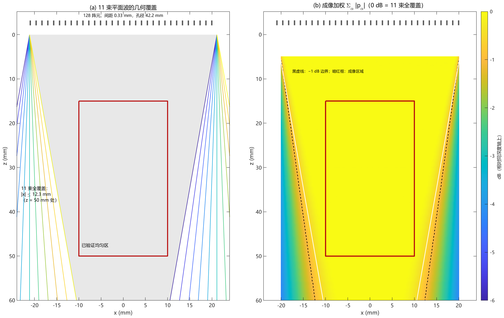
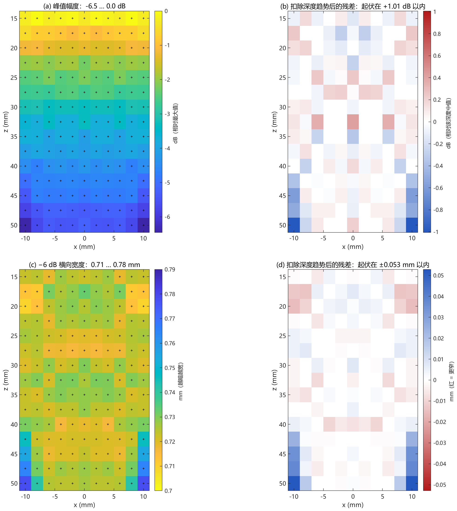
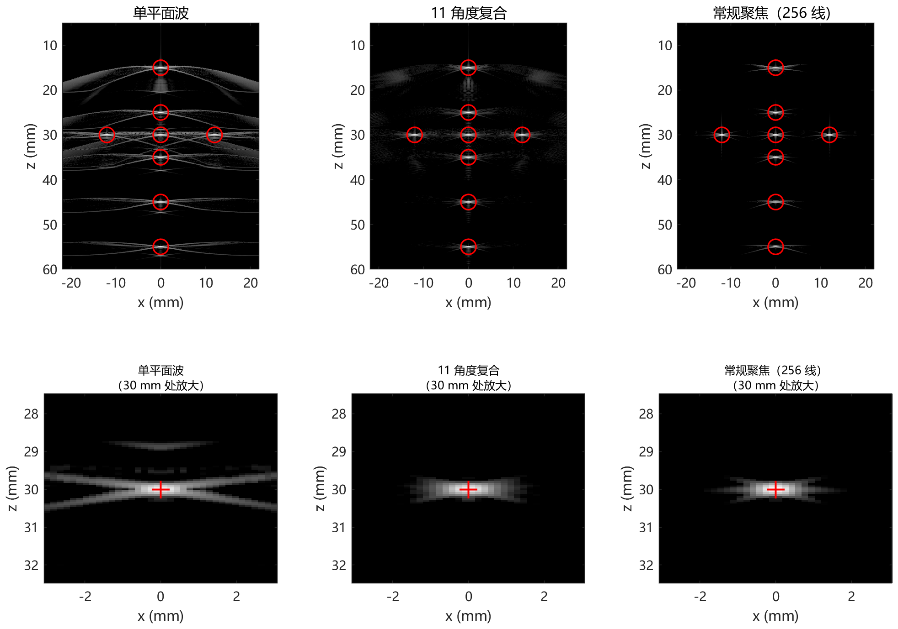

# 超快超声平面波相干复合成像：Field II 仿真实验报告

> **文献**：G. Montaldo, M. Tanter, J. Bercoff, N. Benech, M. Fink, "Coherent Plane-Wave Compounding for Very High Frame Rate Ultrasonography and Transient Elastography," *IEEE Trans. Ultrason. Ferroelectr. Freq. Control*, 56(3):489–506, 2009.
>
> **平台**：MATLAB R2024a + Field II 3.30，Windows 11。`config/params.m` 为唯一参数源，`src/` 36 个函数，`run/` 13 个入口函数。文中数值均由脚本运行产生，可在 `data/res/`（`results.mat`、各 CSV、`tables.md`）追溯。
>
> 讨论、复现步骤与每处修正的来历见 [`实验报告_讨论与附录.md`](实验报告_讨论与附录.md)。

## 1 实验目的

用 Field II 建立 128 阵元线阵、4.5 MHz 的二维仿真环境，在同一组散射子、同一噪声实现下比较三种成像方式：**单平面波（PW，1 次发射）**、**11 角度相干平面波复合（C11，11 次发射）**、**传统逐线聚焦（128 次发射）**。

1. **验证模型**：阵列几何、11 束平面波的公共照明区、发射脉冲与发射声场是否符合平面波的定义（4.1 节）。
2. **打通成像链**：128 通道射频 → DAS → 相干复合，并逐点确认复合后的 PSF 在成像区域内均匀、不产生发射焦区（4.1 节）。
3. **点目标**：8 个强散射子的定位精度，以及横向分辨率随深度的变化（4.2 节）。
4. **囊肿体模**：9 个无回声囊的对比度，复合能把它提高多少（4.3 节）。

实验流程分五步：E0 标定与自检 → E1 聚焦采集 → E2 单平面波采集 → E3 11 角度采集与复合 → E4 指标测量。本报告的重点是第 4 部分，前三部分只给必要背景。

## 2 原理

三种方法共用同一个延时叠加（DAS）框架，区别只在发射方式，因此先讲传统的逐线聚焦（2.1），再讲平面波发射与相干复合（2.2–2.3）。

### 2.1 传统逐线聚焦

第 $l$ 条线的焦点为 $(x_l,0,30\,\text{mm})$，以它为中心、宽 17.14 mm（52 阵元，边缘自动裁剪）的矩形孔径发射，$F^\#=1.75$。接收延时为

$$
\tau=\frac{z+\left(|F|-z_f\right)}{c}+\frac{\sqrt{z^2+(x_l-x_1)^2}}{c}+\frac{|F|-|F-x_1|}{c}+dt .
$$

发射路程是 $|F|+(z-z_f)$：各阵元按 $d(x_1)$ 先后发出，声波收敛到焦点、在 $t=|F|/c$ 同时到达，越过焦点后才沿轴发散——**不是**像素深度 $z$。写成 $z$ 会让离轴线上整体偏深 $(|F|-z_f)/2$（$|x_l|=12$ mm 时 1.16 mm），4.2 节图 F13 的聚焦面板正好把这件事检验出来。128 条线拼成整幅 B 模式，作为分辨率与对比度的参照；每次发射只照亮焦点附近的一条窄带，所以一帧需要 128 次发射。

### 2.2 平面波的发射、接收与 DAS

线阵沿 $x$ 排列，成像区域为 $(x,z)$。倾角 $\alpha$ 的平面波到达点 $(x,z)$ 的时刻、该点回波回到阵元 $x_1$ 的时刻分别为

$$
\tau_{ec}=\frac{z\cos\alpha+x\sin\alpha}{c},\qquad
\tau_{rec}=\frac{\sqrt{z^2+(x-x_1)^2}}{c}.
$$

Field II 把发射延时写进了各通道的时间轴，因此 DAS 的延时取

$$
\tau=\tau_{ec}+\tau_{rec}+\frac{x_1\sin\alpha}{c}+dt .
$$

第三项不是物理路程，而是对上述时间轴约定的补偿（E0 实测：补这一项残差 0.01 µs，不补 1.2 µs）；$dt$ 是全局时间零点。

对每个像素，把孔径内各阵元在 $\tau$ 时刻的射频相加：

$$
s_\alpha(x,z)=\sum_{x_1\in\mathcal{A}(z)}RF_\alpha\!\left(x_1,\tau\right),
\qquad \mathcal{A}(z)=\{x_1:|x_1-x|\le z/(2F)\},
$$

$F=1.75$，窗内矩形、无变迹。一次平面波发射就能重建**整幅**图像，接收焦点逐像素独立形成——不是"聚焦一次、只清楚一个深度"。

### 2.3 相干复合

对 $n$ 个角度分别得到 $s_{\alpha_i}(x,z)$，在取包络**之前**相加：

$$
s_{\text{comp}}(x,z)=\sum_{i=1}^{n}s_{\alpha_i}(x,z),
$$

再做 Hilbert 变换取包络、按 60 dB 对数压缩。先取包络再相加属非相干复合，相位信息已丢，拿不到复合增益，本文不做。角度取 $\alpha_i=(i-6)\cdot2^\circ$（$i=1\ldots11$），即 $0,\pm2^\circ,\ldots,\pm10^\circ$；第 6 个角度为 $0^\circ$，正是单平面波用的那一次发射。

## 3 实验参数

### 3.1 探头与脉冲

| 参数 | 取值 | 依据 |
|---|---|---|
| 阵元数 | 128 | 论文 128（其中 124 有效） |
| 阵元间距 / 宽度 / 高度 | 0.33 / 0.30 / 5 mm | 间距与论文一致；宽度取 kerf 0.03 mm、高度取典型线阵值（论文未给） |
| 中心频率（发射） | 4.5 MHz | 论文 |
| 相对带宽（发射脉冲） | −6 dB 112 %；半功率 78 % | 由 $\sigma=0.32T_c$ 决定，非文献值 |
| 两程实测（30 mm 点散射子） | 4.12 MHz；−6 dB 86.3 %；半功率 62.5 % | E0 实测；60 % 为半功率口径的设计目标 |
| 声速 / 采样率 | 1540 m/s / 30 MHz | 论文（Field II 默认）/ 仿真选择 |
| 接收 F# | 1.75 | 论文 |
| 仰角聚焦 | 无（不建模） | `no_sub_y = 1` 时该参数对结果无影响，已从配置删除 |

发射脉冲为高斯包络正弦（`src/pulse_waveform.m`）：载频 4.50 MHz、$\sigma=0.32T_c$、窗长 5 个周期（1.10 µs）；`xdc_excitation` 取单位冲激，所以单程声压波形就是它本身。

### 3.2 成像与显示

| 参数 | 取值 |
|---|---|
| 成像深度 | 5–60 mm |
| 复合/显示横向 | 256 线，$\Delta x=\lambda/2=0.171$ mm（按标称 4.5 MHz），范围 $\pm21.8$ mm |
| 轴向像素 | 0.05 mm |
| 常规 B 模式横向 | 128 线 @0.33 mm（点目标体模 256 线 @0.171 mm） |
| 插值 / 包络 | 线性 / Hilbert |
| 显示动态范围 | 60 dB（各 B 模式图共用同一色标） |

## 4 实验结果

先给总览，再按"模型与声场 → 点目标 → 囊肿体模"逐组看。

| 指标 | PW | C11 | 单焦点 |
|---|---|---|---|
| 横向 −6 dB 宽度 | 0.83–0.87 mm | **0.74–0.76 mm** | 0.59–0.65 mm（30–32 mm）；0.80–0.95 mm（焦外） |
| 囊肿对比度 \|C\| | 12.8 ± 1.3 dB | **23.3 ± 2.3 dB** | 22.2 ± 5.6 dB |
| 采集帧率（推导值） | 12 833 Hz | **1 167 Hz** | ≈100 Hz |

帧率由序列参数直接推出：

$$
f_{\text{PRF}}=\frac{c}{2z_{\max}}=\frac{1540}{2\times0.06}=12\,833\ \text{Hz},
\qquad
f_{\text{PW}}=f_{\text{PRF}}=12\,833\ \text{Hz},
\qquad
f_{\text{C11}}=\frac{f_{\text{PRF}}}{11}=1\,167\ \text{Hz}.
$$

$f_{\text{PRF}}=c/(2z_{\max})$ 由 60 mm 最深处的往返时间给出；单平面波每个 PRF 只发射一次，11 角度复合每个 PRF 需要 11 次发射，所以帧率降为 1/11。单焦点为逐线扫描，128 条线对应约 100 Hz。

一句话：复合用 11 倍的发射次数，换来横向分辨率收窄 11–13 %、对比度提高 10.5 dB，并把这两项沿深度拉平；单焦点只在焦区局部更好，离开焦区迅速变差。

### 4.1 模型与声场

这一组回答三个问题：换能器在哪、发射的是什么波形、这些波在成像区域里长什么样。后面的分辨率与对比度都建立在这三件事上。

#### 几何、成像区域与 11 束的覆盖范围

**图 F14　11 束平面波的公共照明区与成像加权。** (a) 换能器阵列（画在顶部，成像时位于 $z<0$ 一侧）与 11 束平面波的公共照明区，边界为 |x| ≤ 21.12 − z·tan10° mm（z = 50 mm 时 |x| ≤ 12.3 mm，60 mm 时 ±10.5 mm）；暗红实线框为定量测量的成像区域（|x| ≤ 10 mm、z = 15–50 mm）。(b) $E=\sum_\alpha|p_\alpha|$，即 DAS 补偿各角度相位之后图像实际"看到"的发射加权，按深度归一化；中央一条带为 0 dB，黑色虚线为 −1 dB 等值线，暗红实线框同上。两幅横纵坐标同比例。

**为什么放第一张。** 它同时给出"物理装置"和"数据的定义域"。11 束平面波的倾角最大 $\pm10^\circ$，只有被所有角度都照到的区域，相干叠加才有意义；这个公共区在深处比阵面窄一半（阵面 $\pm21.12$ mm，60 mm 深处只剩 $\pm10.5$ mm）。所以全文的定量测量统一收在暗红框里：$|x|\le10$ mm、$z=15$–50 mm。

**看出什么。** (a) 的边界从阵面两端向轴线收敛，围出一个倒梯形——11 个角度共同照亮的只有这块地方。(b) 的 $E$ 在框内是平的：0 dB 主带覆盖整个框，框内起伏 0.12 dB（最低 −0.08 dB），−1 dB 等值线贴着边界外侧。也就是说，**在测量区域内 11 个角度的照明是均匀的**——4.1 节后面"复合不产生发射焦区"的结论，从这条平坦带已经能预料到。

#### 发射脉冲

**图 F2　发射脉冲的波形与频谱。** 左：单程时域波形，高斯包络正弦，−6 dB 包络宽 0.20 µs。右：幅度谱（$20\log_{10}$）；红杠为 −6 dB 边沿 1.99 / 7.06 MHz（相对带宽 112 %），紫杠为半功率边沿 2.76 / 6.29 MHz（78 %）。该图由参数直接生成，不经 Field II、不含接收端。

**为什么单独测。** 两个原因：一是它决定轴向分辨率（脉冲空间长度 $c\tau/2$）与带宽；二是它是全流程里唯一能脱离 Field II、直接由参数算出来的量，正好用来检查配置有没有写错。

**看出什么。** −6 dB 相对带宽 112 %，半功率 78 %。这里要交代一个口径：全文的"带宽"若无特别说明都指 **−6 dB**。设计目标 60±5 % 是对**两程**回波说的——接收链与孔径的空间响应会再收窄一次：两程实测中心 4.12 MHz、半功率带宽 62.5 %、−6 dB 86.3 %，落在目标内；单程脉冲没有这一道收窄，所以半功率口径更宽（78 %）。

中心频率下移 8 %（4.50 → 4.12 MHz）不是出错：裸阵元没有电-机带通整形，空间响应对高频端衰减更强。载频因此直接取论文标称的 4.50 MHz，不为把两程中心补回 4.5 而抬高它。这条脉冲还给出轴向分辨率的理论值：两程包络 0.24 µs，乘 $c/2$ 得 0.19 mm，与 4.2 节三种方法的实测 0.19–0.20 mm 一致。

#### 单平面波的发射声场

**图 F3　$\alpha=0^\circ$ 的发射峰值声压。** 近场（$z<15$ mm）最强，随深度单调衰减，无焦点；横向在 $\pm20$ mm 内近似均匀，边缘因孔径有限而下降。

**为什么测。** DAS 只补偿相位，不补偿幅度。发射声压在深度上的衰减会原样进入图像，成为 B 模式的亮度趋势；它不改变分辨率，但决定了图像亮度与对比度的深度分布——第 4 节里所有"随深度变化"的现象，都要回到这张图。

**看出什么。** 图上的形状就是平面波的定义：没有焦点、没有腰，只有球面扩散造成的缓降和孔径边缘造成的收窄。$\alpha=0$ 时 $\tau_{ec}=z/c$，同一深度的所有横向位置同时被照亮。

#### 11 个角度的声场

**图 F4　6 个代表角度的发射声场。** $\alpha=\pm2^\circ,\pm6^\circ,\pm10^\circ$ 六幅，均为峰值声压，色标各幅独立归一化。

**为什么测。** 要确认"倾斜"真的发生在仿真里，而不只是写在公式里。E0 用斜率比检验：相邻角度的回波到达时间差应为 $\sin\alpha\,\Delta x/c$，实测比值 1.001（$\pm5^\circ$ 与 $\pm10^\circ$），说明倾角、声速、时间轴三者自洽。

**看出什么。** 六幅在中央区域几乎一样平，差别集中在贴边的一条亮暗过渡带上：带的位置随 $\alpha$ 的符号换边，宽度随 $|\alpha|$ 增大。这有两层含义——中央照明对 11 个角度是等价的（复合才有意义），而有效照明在边缘处随角度移动（这就是图 F14 那条收缩边界的物理来源，也是定量区域只取 $\pm10$ mm 的原因）。

#### 复合后的点扩散函数与成像区域均匀性

在 $x=-10\ldots10$ mm（11 个点，间隔 2 mm）、$z=15\ldots50$ mm（15 个点，间隔 2.5 mm）共 165 个网格点上逐点放一个单散射子，每点都跑完整链路：11 个角度发射 → 128 通道 → DAS → 射频域相加 → 取包络，再测该点的峰值幅度、−6 dB 横向与轴向宽度、相干因子和峰值位置。

**图 F5　成像区域内的点扩散函数。** 四幅按 $2\times2$ 排：上排峰值幅度，下排 −6 dB 横向宽度；每排左为地图、右为扣除深度趋势后的残差。暖色一律表示"更好"（幅度高、宽度窄）。

**为什么测。** 两个目的。第一，单看一个点只能说明"复合在这一点好不好"，说明不了整块区域，而复合的卖点恰恰是"处处一样"。第二，要排除一个容易产生的误解——以为 11 个角度会在某个深度"合成一个发射焦点"。若真如此，PSF 宽度应当先窄后宽，图上出现一个 waist。

| 指标 | 结果 |
|---|---|
| 峰值幅度（全图归一化） | −6.5 … 0.0 dB（深度方向 5.3 dB 的缓降） |
| 扣除深度趋势后的残差 | ±1.01 dB |
| 同一深度内的横向起伏 | ≤1.22 dB；\|x\| ≤ 8 mm 内 ≤0.46 dB |
| 横向 −6 dB 宽度 | 0.71–0.74 mm（\|x\| = 10 mm、z ≥ 45 mm 的 6 个点升到 0.76–0.78 mm） |
| 轴向 −6 dB 宽度 | 0.19–0.20 mm（均值 0.193，标准差 0.001） |
| 相干因子 | 0.982–0.994 |
| 峰值位置偏差 | 横向 ≤0.05 mm、轴向 0.00 mm |

**看出什么。** 三条。

1. **宽度不变**：横向 0.71–0.74 mm 在 15–50 mm 内起伏只有 ±0.02 mm，轴向 0.19–0.20 mm 更是平坦。PSF 不随深度变化——这就是"无焦点"的直接证据，图上没有 waist。
2. **幅度缓降**：全图 −6.5…0 dB，深度方向 5.3 dB，与 $1/\sqrt z$ 的球面扩散一致；扣掉这条趋势后残差只剩 ±1.01 dB。**这一点很重要**：单焦点的对比度随深度差 12.7 dB（4.3 节），而复合只剩 4 dB 量级。
3. **6 个例外**：横向宽度升到 0.76–0.78 mm 的点全在 $|x|=10$ mm、$z\ge45$ mm，那里已经贴到图 F14 的公共照明边界，有效孔径被截掉一角。这不是复合的缺陷，而是 11 束几何覆盖的必然结果。

相干因子 0.982–0.994、位置偏差 ≤0.05 mm，说明 11 个角度确实同相叠加、没有错位。这张表同时是 4.2 节分辨率数字的独立验证：这里逐点测得 0.71–0.78 mm，那里沿轴测得 0.74–0.76 mm。

#### 128 通道数据与成像链

**图 F6　同一次 $0^\circ$ 发射的通道数据、DAS 成像与 11 角度复合。** 三幅同坐标、同比例（换能器在上）。(a) 128 个通道的接收射频幅度：横轴为阵元位置，纵轴为往返深度 $z=ct/2$。(b) 这组通道数据经 DAS 与包络后的 B 模式。(c) 再加 10 个角度做相干复合（C11）。

**为什么测。** 前面的图都是"结果"，这一张是"过程"。它把 128 通道原始数据、DAS、复合三步并排摆出来，是后面所有指标的机械基础；讲解时也可以用它说明"一个点为什么在通道域是一条双曲线、又怎么被拉平"。

**看出什么。** 三点，正好对应三幅。

1. **(a) 双曲线。** 同一点目标的回波到达各阵元的时间不同，最近的阵元先收到。15 mm 处的目标，轴上对应 16.0 mm、边缘阵元 21.0 mm，折合 6.5 µs；55 mm 处只弯约 2 mm。这条曲线就是 2.2 节的 $\tau$ 要在每个像素上补偿掉的东西。
2. **(b) 单角度 DAS。** 曲线被拉平，点聚成亮点；但斜向旁瓣很强，$\pm12$ mm 的两个目标埋在旁瓣里。
3. **(c) 11 角度复合。** 旁瓣被压掉、点变紧，30 mm 处 −6 dB 横向宽度由 0.84 mm 收到 0.75 mm（与 4.2 节的表一致），$\pm12$ mm 的两个目标从旁瓣里显出来。

三幅只画 $z=15$–60 mm：这一帧记录（1788 点、59.6 µs）从第一个可能回波起算，正好覆盖 15–60.9 mm。

### 4.2 点目标：定位与横向分辨率

点目标体模 P3 有 8 个强散射子（幅度 30，远强于背景散射子）：轴上 6 个（$z=15、25、30、35、45、55$ mm），加上 30 mm 处 $x=\pm12$ mm 各一个。它首先回答"图像把点放在哪里"（几何对不对）。"一个点被模糊成多大"则另用轴上逐点实验来测（见 4.2 节最后一段）：在 $x=0$ 上每 2 mm 只放一个散射子、放一个扫一遍，26 个深度连成一条曲线，比 P3 的 6 个深度密得多。

**分辨率的度量方式**：横向分辨率取点目标横向包络的 −6 dB 全宽（半幅度），即包络降到峰值一半处的两个交叉点之间的距离，交叉点由 8 倍 pchip 上采样后求得；轴向同法。

#### 8 点图像与定位

**图 F13　8 个点目标在三种方法下的图像。** 上排三幅为单平面波、11 角度复合、常规聚焦（256 线），红圈为散射子真实坐标；下排为 $(0,30\,\text{mm})$ 附近 $x=\pm3$ mm、$z=28$–32 mm 的放大图，红十字为真实位置。

**为什么测。** 这是唯一"真实位置已知"的体模，图像上的亮点可以直接和坐标对；8 个点又分布在整个深度上，一眼能看出 PSF 随深度怎么变。

**看出什么。** 三方面。

- **位置**：三种方法都把 8 个点放在正确位置。C11 用三点抛物线拟合的误差为 3 µm（横向）/ 12 µm（轴向），常规聚焦 23 / 10 µm。像素峰值给出的 $\pm86$ µm **不是误差**，而是线距的一半：256 线为偶数，$x=0$ 落在第 128 与 129 列之间。
- **形状**：PW 的每个点都拖出两条斜向"翅膀"，远处目标的翅膀互相交叠，$\pm12$ mm 的两个点几乎淹没在旁瓣里；C11 的翅膀被压掉，点成为紧致椭圆；聚焦在焦区最紧，离开焦区逐渐变宽。
- **放大图**：30 mm 处 PW 是"蝴蝶形"（两个主旁瓣在横向张开），C11 是一个干净的横向椭圆，聚焦的椭圆更窄。这是三种方法 PSF 形状差异最直观的一处，4.2 节后面的宽度数字就是它的定量版本。

顺带说明：聚焦面板里 $\pm12$ mm 两个点能被正确重建，是 2.1 节发射项 $|F|+(z-z_f)$ 的验收——若沿用 $z$，整条线会偏深 1.16 mm（归档 B20）。

#### 横向分辨率随深度

**图 F10　横向 −6 dB 宽度随深度的变化（轴上逐点单散射子）。** 在 $x=0$ 上每 2 mm 放一个散射子（$z=10$–60 mm，共 26 个），一次只放一个，每放一次把三种方法的成像链各重跑一遍，再量该深度峰值行的 −6 dB 全宽；判据与表 T-B 相同（0.171 mm 线网格、±5 mm 窗口、8 倍 pchip 上采样）。浅灰细线是常规聚焦的 0.5 mm 细扫：另外 75 个深度上各放一个散射子、各自单独成像测量（不是插值，也不是"更准的版本"），用来测出三角标记之间那段形状。

**表 T-B 横向分辨率（−6 dB 宽度，mm）**

| 方法 | 15 mm | 25 mm | 30 mm | 35 mm | 45 mm | 55 mm |
|---|---|---|---|---|---|---|
| PW | 0.86 | 0.85 | 0.84 | 0.83 | 0.83 | 0.85 |
| **C11** | **0.74** | **0.75** | **0.75** | **0.74** | **0.75** | **0.75** |
| 单焦点 | 0.84 | 0.90 | **0.65** | 0.83 | 0.86 | 0.80 |

表中的数值来自 P3 八点体模的整幅图像。逐点实验在同样这六个深度上读到 0.840 / 0.898 / 0.645 / 0.825 / 0.859 / 0.795 mm，与表一一对应：两条独立路径（多目标整幅成像、单目标逐点重扫）给出同一组数字，所以表和图可以放在一起引用。

**为什么测。** 单个点的宽度只说明一个深度，而"复合是否把分辨率拉平"必须沿深度看——这也是复合与聚焦最本质的区别：聚焦把最好的分辨率集中在一个深度上，复合把它摊到全深度。逐点放、逐点扫还有一个好处：每个深度都是一次独立实验，测到的宽度只由该深度的孔径与声场决定，不依赖体模里其他目标摆在哪儿。

**看出什么。** 五条。

1. **两条平线**：PW 0.83–0.87 mm（26 个点，起伏 0.04 mm）、C11 0.74–0.76 mm（起伏 0.02 mm）；C11 比 PW 窄 11–13 %，而且这个差值沿深度不变。复合带来的分辨率改善**不随深度变化**，与图 F5 的 PSF 地图一致。
2. **一条 V**：单焦点在 30–32 mm 压到最低（2 mm 采样 0.63 mm，细扫 0.59 mm），与接收衍射极限 $\lambda F^\#=0.65$ mm 同量级（$\lambda$ 取两程中心 4.12 MHz 的 0.374 mm）；离开焦区升到 0.90–0.95 mm（40–42 mm），之后在 0.80–0.92 mm 之间起伏而不再继续变差。远处不再是发射决定的：动态接收孔径始终保持 $F^\#=1.75$（0.65 mm），发射波束虽然发散，两者相乘后仍维持在 0.86 mm 左右。
3. **V 上的纹波**：曲线上的锯齿不是噪声，也不是测量抖动——每个点都是该深度单独成像、单独量出来的，中间没有插值。锯齿来自场本身：矩形发射孔径的边缘波在焦区形成约 1.8 mm 周期的轴向纹波（`calc_hp` 直接量的轴上峰值声压起伏 4–6 dB），点目标落在波峰与波谷上，测到的宽度最多差 0.1 mm（25 mm 落在波峰上是 0.90，24 / 26 mm 落在谷里是 0.80 / 0.72）。2 mm 的网格只有 26 个深度，分辨不出这个尺度的起伏；浅灰细线是另外 75 个深度（每 0.5 mm 各放一个散射子、各自单独成像），用来把两点之间的形状也测出来——它与三角标记在重合的 26 个深度上逐位相同。
4. **为什么 C11 是 0.75 而不是 0.65**：它的横向仍由发射决定。$\pm10^\circ$ 的合成发射孔径等效 $F_{\text{syn}}\approx1/(2\sin10^\circ)=2.88$，比接收的 1.75 粗，所以比衍射极限高 15 %。若想再窄，就得加角度或加大角度——代价是帧率。
5. **轴向不作为比较项**：三种方法都是 0.19–0.20 mm，与脉冲长度 $c\tau/2$ 一致，与焦点和复合都无关（归档 B14）。

### 4.3 囊肿体模

囊肿体模 P2 有 9 个无回声囊（直径 6 mm，中心在 $x=-12/0/12$ mm、$z=20/35/50$ mm）。它回答的问题只有一个：**囊内比背景暗多少**——也就是成像系统把旁瓣泄漏压到什么程度。

#### B 模式

**图 F8　囊肿体模的 B 模式。** PW / C11 / 单焦点三幅，共用同一 60 dB 色标，$x=\pm21.8$ mm、$z=5$–60 mm。

**为什么先看图再看数。** 指标是给量化用的，但判断"有没有问题"最快的方式还是看图——如果图像里囊都不成形，后面的数字就不必看了。三幅共用同一色标，可以直接横比。

**看出什么。** PW 的囊边界发虚、内部不够黑；C11 的囊最黑、边界最锐；聚焦在焦区（30–35 mm）最黑，但 20 mm 与 50 mm 的囊明显变亮。把下一节的数字按深度摊开：聚焦三行是 21.2 / 29.0 / 16.3 dB，跨度 12.7 dB；C11 是 21.2 / 23.3 / 25.3 dB，跨度只有 4.1 dB。**这就是"焦区好、焦外差"在图像上的样子**，也解释了为什么两者的均值几乎相同、标准差却差 2.4 倍。

#### 对比度

对比度定义在**强度**（包络的平方）上，量的是囊内平均强度比囊外低多少：

$$
C=10\log_{10}\frac{\mu_{in}}{\mu_{out}},
$$

$\mu_{in}$、$\mu_{out}$ 为囊内、囊外的强度均值。刻度是 $10\log_{10}$（功率比），它与"幅度比取 $20\log_{10}$"完全等价，也与 B 模式的显示刻度一致。囊内更暗，$C$ 为负值，报告一律写 $|C|$。

测量区域：囊内取 $r\le2$ mm 的圆盘（离囊壁留 1 mm，避开壁的强回波向里渗约一个 PSF 宽度），囊外取 $4\le r\le6$ mm 的环带（避开壁外过渡带；6 mm 为相邻囊心间距 12 mm 的一半，再大就碰到隔壁）。两区之间的 2–4 mm 故意不用。

**图 F11　9 个囊肿的对比度。** 三种方法并列，每种有无噪声与含噪声两根柱子；柱高为 9 个囊肿的 $|C|$ 均值，误差棒为标准差。

**为什么测。** B 模式是 60 dB 对数压缩的，肉眼看"黑不黑"会被显示刻度带偏；而且"黑"是相对的，必须相对背景来量。对比度把这件事量化，只由囊内外的强度比决定，与显示设置无关。

**看出什么。** 四条。

1. **12.8 / 23.3 / 22.2 dB**（9 个囊肿的均值 ± 标准差：12.8 ± 1.3、23.3 ± 2.3、22.2 ± 5.6 dB）。C11 比 PW 高 10.5 dB——复合压低了旁瓣泄漏，囊内更干净。
2. **含噪值低 0.9–2.1 dB**（11.9 / 21.6 / 20.1 dB）。噪声在射频域叠加、一起被波束形成，囊内被噪声底填亮。这是"无噪/含噪两套分开报"的原因。
3. **均值相同不等于一样好。** 单焦点 22.2 dB 与 C11 23.3 dB 只差 1.1 dB，但标准差 5.6 对 2.3（2.4 倍），按深度摊开是 21.2 / 29.0 / 16.3 对 21.2 / 23.3 / 25.3 dB。**聚焦把对比度堆在焦区，复合把它摊平**——这与表 T-B 里"一条漏斗、两条水平线"是同一件事的两个侧面。
4. **$|C|$ 的物理含义**：它是"系统能把囊内压到背景以下多少 dB"，受限于旁瓣泄漏与部分容积效应，不是"囊里少了多少回波"。所以它衡量的是 PSF 把能量挡在区域外的能力。
