# 超快超声平面波相干复合成像：Field II 仿真实验报告

> **依据文献**：G. Montaldo, M. Tanter, J. Bercoff, N. Benech, M. Fink, "Coherent Plane-Wave Compounding for Very High Frame Rate Ultrasonography and Transient Elastography," *IEEE Trans. Ultrason. Ferroelectr. Freq. Control*, vol. 56, no. 3, pp. 489–506, Mar. 2009.
>
> **仿真平台**：MATLAB R2024a（24.1.0.2537033）+ Field II 3.30，Windows 11。
>
> **代码**：`config/params.m`（唯一参数源）、`src/`（23 个函数）、`run/`（驱动脚本）；原始数据在 `data/`，图在 `figures/`。
>
> **状态**：本报告的全部数值均由脚本实际运行产生，可在 `data/res/` 中追溯（`results.mat`、各 CSV）。

---

## 摘要

本实验用 Field II 复现了 Montaldo 等（2009）的单平面波成像与相干平面波复合（CPWC），并以传统逐线聚焦 B 模式为对照，在同一体模、同一噪声水平下比较三者的横向/轴向分辨率、囊肿对比度、CNR 与 SNR。主要结论如下（数值见第 5 节）：

- 单平面波的 −10 dB 横向宽度为 **1.00 mm** 且与深度无关；71 角度相干复合后降为 **0.82 mm**，与单焦点在其焦点处的 0.77 mm 相当；在焦点之外（45–55 mm），单焦点退化到 1.59 mm，而复合仍保持 0.82 mm。
- 9 个囊肿的平均对比度从 **25.2 dB**（PW）提升到 **55.8 dB**（C71），提升 30.6 dB；单焦点为 30.4 dB 且随深度剧烈起伏（标准差 13.4 dB）。
- 相对 SNR 随角度数增长但**低于理想 10log₁₀n**：C5 5.7、C9 8.3、C17 11.0、C33 11.4、C45 12.3、C71 **15.6 dB**（理论 7.0/9.5/12.3/15.2/16.5/18.5 dB）。补充实验证明这**不是**散射子密度造成的（密度提高 4 倍只增加 0.4 dB）；点目标的相干因子为 0.92，而散斑只有约 0.25——散斑目标在不同角度下的实现并不相同，因此 10log₁₀n 对散斑只是上界。
- 相干复合必须在**取包络之前**相加；本实验严格在 RF 域叠加，复合后的合成发射场在 30 mm 聚焦，焦点增益 62.9（理论 71），横向剖面与同孔径物理聚焦几乎重合。
- **实现层面的一条重要结论**：Field II 的 `calc_scat_multi` 把阵元发射延时写进了通道时间轴，自定义 DAS 必须把 $x_1\sin\alpha/c$ 计入延时模型，否则图像被剪切 $\Delta x=-z\sin\alpha$（16.5° 时约 8.5 mm）、复合完全失效（见 6.1）。

---

## 1 实验目的

1. 用 Field II 建立 128 阵元线阵、4.5 MHz、60% 带宽的二维仿真环境；
2. 生成传统逐线聚焦 B 模式图像，作为分辨率与对比度的参照；
3. 生成单平面波的发射声场、128 通道原始射频（RF）、波束形成后的 RF 与 B 模式；
4. 实现相干平面波复合：每个角度的声场、合成发射声场、1/5/9/17/33/45/71 个角度的复合 B 模式与 RF；
5. 用统一体模与统一噪声模型定量比较三种方法的横向分辨率、对比度与信噪比；
6. 对均匀随机散射子体模成像，检查散斑统计与分辨率均匀性；
7. 所有参数以论文为准，凡有改动逐项说明（第 3.4 节）。

---

## 2 方法

### 2.1 平面波的发射与接收

线阵沿 $x$ 排列，成像区域为 $(x,z)$。倾角为 $\alpha$ 的平面波到达点 $(x,z)$ 的时间为

$$
\tau_{ec}(\alpha,x,z)=\frac{z\cos\alpha+x\sin\alpha}{c},
\tag{1}
$$

回波到达位于 $x_1$ 的阵元的时间为

$$
\tau_{rec}(x_1,x,z)=\frac{\sqrt{z^2+(x-x_1)^2}}{c}.
\tag{2}
$$

双程延时为二者之和。对每个像素，把孔径内各阵元在 $\tau$ 时刻的 RF 取值相加：

$$
s_\alpha(x,z)=\sum_{x_1\in\mathcal{A}(z)} RF_\alpha\!\left(x_1,\tau(\alpha,x_1,x,z)\right),
\qquad \mathcal{A}(z)=\{x_1:|x_1-x|\le z/(2F)\},
\tag{3}
$$

$F=1.75$，孔径内矩形窗、无变迹（与论文一致）。

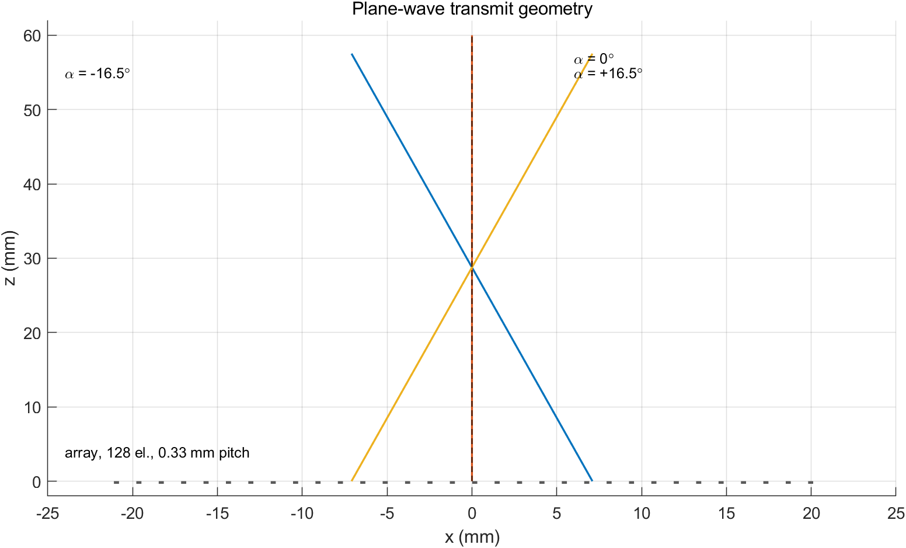

**图 F1** 为阵列几何与三个代表角度的平面波波前示意：128 阵元、0.33 mm 间距、孔径 42.24 mm；成像区域 5–60 mm。

> **实现中发现的库特性（重要）**：Field II 的 `calc_scat_multi` 返回的每一通道信号，其时间轴上都叠加了该阵元的**发射激励延时** $d(x_1)$。E0 用单散射子实测：把 $d(x_1)$ 计入成像模型后，各通道回波峰值时刻相对模型的残差为 **0.010 µs**；不计入则为 **1.22 µs**。因此式 (3) 的实现为
> $$
> \tau=\frac{z\cos\alpha+x\sin\alpha}{c}+\frac{\sqrt{z^2+(x-x_1)^2}}{c}+\frac{x_1\sin\alpha}{c}+dt .
> $$
> 若忽略这一项，图像会沿 $x$ 方向被剪切 $\Delta x=-z\sin\alpha$（16.5° 时约 8.5 mm），复合完全失效。聚焦发射同理，发射延时由程序显式给出并在 DAS 中扣除。

### 2.2 相干复合

对 $n$ 个角度分别按式 (3) 得到 $s_{\alpha_i}(x,z)$，在**包络检测之前**直接相加：

$$
s_{\text{comp}}(x,z)=\sum_{i=1}^{n} s_{\alpha_i}(x,z),
\tag{4}
$$

再做 Hilbert 变换取包络、对数压缩显示。若先取包络再相加即非相干复合，不能重建发射聚焦，本实验不做这种处理。

### 2.3 角度集合

$$
\sin\alpha_i=\frac{i\lambda}{L},\qquad i=-\frac{n_t}{2},\ldots,\frac{n_t}{2}-1,
\tag{5}
$$

其中 $L=n_t\,dx=42.24$ mm，$\lambda=c/f_0=0.3422$ mm。达到与最优多焦点相同横向聚焦所需的角度数为

$$
n=\frac{L}{\lambda F}\approx 70.5 .
\tag{6}
$$

本实验取中心 71 个角度（$i=-35,\ldots,35$），最大角 ±16.47°，中心角间隔 0.464°。

复合子集（复用同一批 71 角度数据）：

| 组名 | $n$ | $i$ 的集合 | 最大角 | 采集帧率（推导值） |
|---|---|---|---|---|
| PW | 1 | $\{0\}$ | 0° | 12833 Hz |
| C5 | 5 | $\{0,\pm8,\pm16\}$ | ±7.4° | 2567 Hz |
| C9 | 9 | $\{0,\pm4,\pm8,\pm12,\pm16\}$ | ±7.4° | 1426 Hz |
| C17 | 17 | $\{0,\pm2,\ldots,\pm16\}$ | ±7.4° | 755 Hz |
| C33 | 33 | $\{0,\pm1,\ldots,\pm16\}$ | ±7.4° | 389 Hz |
| C45 | 45 | $\{0,\pm1,\ldots,\pm22\}$ | ±10.3° | 285 Hz |
| C71 | 71 | 全部 | ±16.5° | 181 Hz |

### 2.4 传统逐线聚焦

发射：第 $l$ 条线的焦点 $(x_l,0,30\,\text{mm})$，以 $x_l$ 为中心、宽 17.14 mm（52 阵元，边缘自动裁剪）的矩形孔径，$F^\#=1.75$。接收延时按

$$
\tau(x_1,x_l,z)=\frac{z+\sqrt{z^2+(x_l-x_1)^2}}{c}+d(x_1)+dt .
\tag{7}
$$

### 2.5 噪声模型

在**通道数据**上叠加独立同分布高斯白噪声（每个阵元、每次发射独立），再波束形成。这样 $n$ 次发射的噪声互不相关，复合时信号相干相加 $n$ 倍、噪声非相干相加 $\sqrt{n}$ 倍，才有 $10\log_{10}n$ 的增益。

噪声标准差由单平面波在 30 mm 处的目标 SNR（20 dB）标定：

$$
\sigma_e=\sqrt{\frac{\overline{s^2}}{\,10^{\mathrm{SNR}/10}\cdot\overline{\sum w^2}\,}} ,
$$

其中 $\overline{\sum w^2}$ 是 DAS 线性插值权重平方和。DAS 为线性运算，噪声经波束形成后的方差可由权重精确传播：

$$
\sigma_N^2(x,z)=\sigma_e^2\sum_{i}\sum_{x_1}w_{i,x_1}^2(x,z),
\qquad
\mathrm{SNR}(x,z)=10\log_{10}\frac{\overline{s^2(x,z)}}{\sigma_N^2(x,z)} .
$$

该解析式在 E0 中用 20 次蒙特卡洛验证（结果见 5.1 节）。

### 2.6 评价指标

| 指标 | 定义 | 测量区域 |
|---|---|---|
| 横向分辨率 | 点目标横向包络的 −10 dB 全宽（线性插值找交叉点） | P3，z = 15…55 mm |
| 轴向分辨率 | 点目标轴向包络的 −6 dB 全宽 | 同上 |
| 囊肿对比度 | $C=20\log_{10}(\mu_{in}/\mu_{out})$，$\mu$ 为包络平方（强度）均值 | 囊内 $r\le2$ mm；囊外 $4\le r\le6$ mm |
| CNR | $\mathrm{CNR}=\dfrac{|\mu_{out}-\mu_{in}|}{\sqrt{\sigma_{out}^2+\sigma_{in}^2}}$ | 同上 |
| SNR | $10\log_{10}(\overline{s^2}/\sigma_N^2)$，5×5 mm 滑窗 | P1，z = 15…55 mm |
| 相对 SNR | 各方法 SNR 减去 PW 在 30 mm 的 SNR | 同上 |
| 散斑 μ/σ | 强度均值/标准差 | 10×10 mm ROI |

对比度与分辨率用**无噪声**图像测量（受旁瓣限制），另给出含噪图像的对比度作为对照；所有方法共用同一组散射子与同一噪声实现。

---

## 3 仿真参数

### 3.1 探头与声学参数

| 参数 | 取值 | 依据 |
|---|---|---|
| 阵元数 | 128 | 论文 128（其中 124 有效） |
| 阵元间距 | 0.33 mm | 论文 |
| 阵元宽度 | 0.30 mm | 取 kerf 0.03 mm（论文未给） |
| 阵元高度 | 5 mm | 典型线阵值（论文未给） |
| 仰角聚焦 | 30 mm | 取成像中部（论文未给） |
| 中心频率 | 4.5 MHz | 论文 |
| −6 dB 带宽 | 60% | 论文，实测 62.8% |
| 声速 | 1540 m/s | 论文/Field II 默认 |
| 采样率 | 30 MHz | 仿真选择（约 6.7 点/周期） |
| 接收 F# | 1.75 | 论文 |

**脉冲标定**：`xdc_impulse` 用高斯包络正弦（载频 4.90 MHz，$\sigma=0.32/f_0$，5 周期窗），`xdc_excitation` 取单位冲激；两程脉冲的实测中心频率 4.45 MHz、−6 dB 带宽 62.8%。

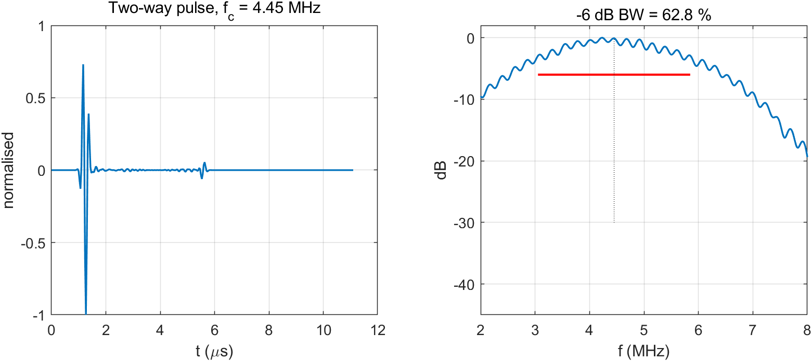

**图 F2** 左：两程脉冲波形（−6 dB 包络宽度 0.267 µs，对应轴向 0.205 mm）；右：频谱与 −6 dB 带宽标注。

### 3.2 成像与显示参数

| 参数 | 取值 |
|---|---|
| 成像深度 | 5–60 mm |
| 复合/显示横向 | 256 线，$\Delta x=\lambda/2=0.171$ mm，范围 ±21.8 mm |
| 轴向像素 | 0.05 mm |
| 常规 B 模式横向 | 128 线 @0.33 mm（点目标体模用 256 线 @0.171 mm） |
| 插值 | 线性 |
| 包络 | Hilbert |
| 显示动态范围 | 60 dB |
| 采集帧率（推导值） | $f_{PRF}=c/(2z_{max})=12.83$ kHz，$f_{FPS}=f_{PRF}/n$ |

### 3.3 体模

| 体模 | 内容 | 用途 |
|---|---|---|
| P1 均匀散斑 | 20 000 个零均值高斯幅度散射子，$x\in[-22,22]$ mm，$z\in[5,60]$ mm，$y=0$ | 均匀成像、SNR、散斑统计 |
| P2 囊肿 | P1 减去落在 9 个无回声圆囊内的散射子（半径 3 mm，$x=-12/0/12$ mm，$z=20/35/50$ mm） | 对比度、CNR |
| P3 点目标 | 8 个强点散射子（幅度 30）：$(0,15/25/30/35/45/55)$、$(\pm12,30)$ mm | 分辨率 |

P2 利用 Field II 对散射子幅度的线性性：先对 P1 全量采集一次，再只对“被移除的散射子”采集一次，两者通道数据相减即得 P2，严格等价、省一次全量仿真。随机种子固定 `rng(2009)`。

### 3.4 与论文参数的差异

| 项目 | 论文 | 本实验 | 原因 | 影响 |
|---|---|---|---|---|
| 有效阵元 | 124（4 通道坏） | 128 | 仿真简便、孔径对称 | 孔径 +3%，可忽略 |
| 采样率 | 未给 | 30 MHz | 计算量 | 线性插值误差 −21.6 dB |
| 常规 B 模式线数 | 256 @0.17 mm | 128 @0.33 mm | 计算量减半 | 0.33 mm 对 1.1 mm 分辨率仍有 3 点/半宽 |
| 体模维度 | 三维 | 二维（$y=0$） | 计算量 | 无切片厚度积分，散斑统计需检查 |
| 散射子密度 | 实际体模 | 8.3 个/mm² | 计算量 | 每个分辨单元约 4–5 个散射子 |
| 衰减 | 有 | 基线无 | 隔离波束形成差异 | 只比较相对 SNR |
| 囊肿直径 | 约 4 mm | 6 mm | ROI 更稳健 | 对比度绝对值可能略高 |
| 4 焦点参考 | 有 | 未做（默认） | 计算量 +6 h | — |
| 复合角度子集 | 2°/1°/0.5° 等间隔 | 式 (5) 网格子集 | 复用 71 角度数据 | 收敛趋势一致 |
| 帧率 PRF | 12.5 kHz | 12.83 kHz | 深度 60 mm | +2.6% |

---

## 4 实验流程

| 阶段 | 内容 | 输出 |
|---|---|---|
| E0 | 带宽、倾角斜率、时间零点、孔径、插值、噪声传播自检 | `calib.mat`、F2 |
| E1 | 单焦点逐线 B 模式（128 线；点目标体模 256 线） | F8/F9 中的单焦点面板 |
| E2 | 单平面波：声场、128 通道 RF、波束形成 RF 与 B 模式 | F3、F6、F7 |
| E3 | 71 角度采集 + 相干复合（7 个子集）+ 合成声场 | F4、F5、F7、F8、F9 |
| E4 | 分辨率、对比度、CNR、SNR | F10–F12、表 T-B…T-E |
| E5 | 均匀散斑统计与横向均匀性 | F13、表 T-F |

采集全部采用“每角度/每线单独存盘 + 启动时跳过已存在文件”的断点续跑方式；长任务在独立 MATLAB worker（`batch`）中运行，日志写入 `data/logs/core.log`。

---

## 5 实验结果

### 5.1 E0 标定与自检

| 项目 | 结果 | 判据 | 结论 |
|---|---|---|---|
| 中心频率 | 4.45 MHz | 4.5 ± 0.1 MHz | 通过 |
| −6 dB 相对带宽 | 62.8 % | 60 ± 5 % | 通过 |
| 倾角斜率比（10°） | 0.999 | 1 ± 0.05 | 通过 |
| 倾角斜率比（16.5°） | 0.979 | 1 ± 0.05 | 通过 |
| 时间零点校正 $dt$ | 1.226–1.264 µs，极差 0.038 µs | 与角度无关的常数 | 通过 |
| 线性 vs 样条插值 | 最大差 −21.6 dB（相对峰值） | 主瓣一致 | 通过 |
| 20k 散射子单次发射 | 冷启动 46.4 s；71 角度循环中稳定 26.5–29.7 s | — | — |
| 噪声标定 $\sigma_e$ | $4.867\times10^{-25}$ | PW@30 mm = 20 dB | — |
| 噪声解析式 / 蒙特卡洛 | 0.962 ± 0.157 | 1.0 | 通过 |
| 接收孔径 | 10/30/60 mm 处 18/52/104 阵元 | $F^\#=1.75$ | 通过 |

**时间零点 $dt$ 的物理含义**：把每通道的发射激励延时 $d(x_1)$ 计入 DAS 模型后，各角度的残余时间零点几乎完全相同（极差 0.038 µs，约 1 个采样点），说明模型已经“吸收”了角度依赖；剩下的是一个与角度无关的固定群延迟 1.24 µs（脉冲波形本身的延迟 + 空间冲激响应）。校正后，点目标在 1/19/36/71 四个角度的重建深度分别为 29.974/29.991/29.995/29.974 mm，误差 ≤ 0.03 mm。

**噪声传播**：20 次蒙特卡洛得到的波束形成后噪声标准差与解析式 $\sigma_e\sqrt{\sum w^2}$ 之比为 0.962 ± 0.157（逐像素比值的均值±标准差），确认 DAS 线性噪声模型可用。比值略小于 1 是因为蒙特卡洛样本有限且相邻像素的噪声相关。

### 5.2 单平面波：发射声场、通道数据与波束形成

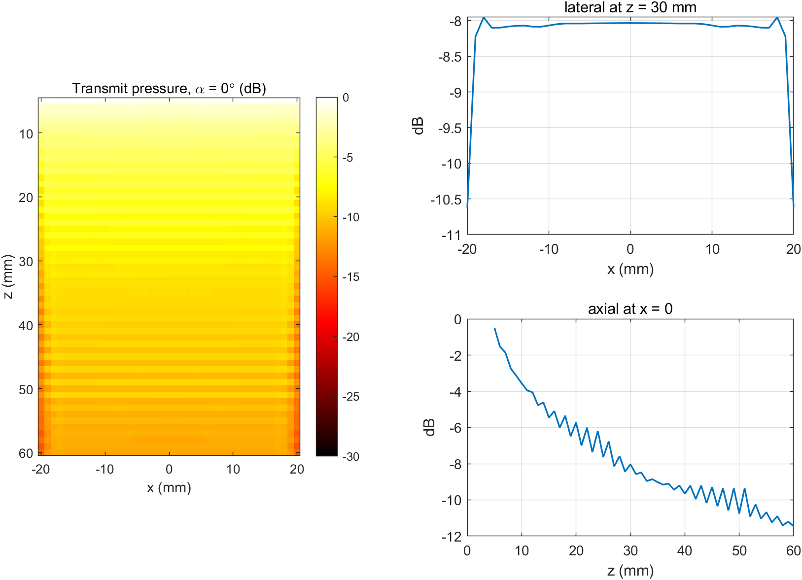

**图 F3** 为 $\alpha=0^\circ$ 的发射峰值声压。近场（$z<15$ mm）最亮，随深度单调衰减（约 $1/\sqrt{z}$），**没有焦点**——这正是平面波发射不聚焦的直观表现；横向在 ±21 mm 内近似均匀，边缘因孔径有限而下降。

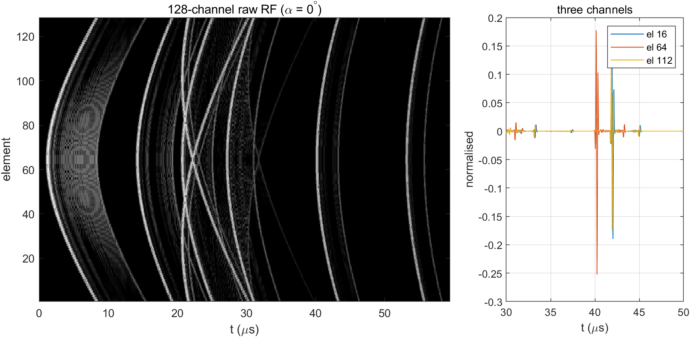

**图 F6** 为 128 通道原始 RF。可以看到：
- 各通道回波时间随阵元位置呈双曲线（点目标在 30 mm 处，中心通道最早）；
- 三条代表性通道（16/64/112）的波形，中心通道比边缘通道早约 0.5 µs；
- 记录长度 2746 采样点（91.5 µs），对应 5–60 mm 的往返时间。

单角度波束形成后的 RF 与 B 模式见图 F7 左侧；波束形成前的 RF 图（F7）在取包络前是双极性振荡，取包络后才是 B 模式。

### 5.3 相干复合与合成发射声场

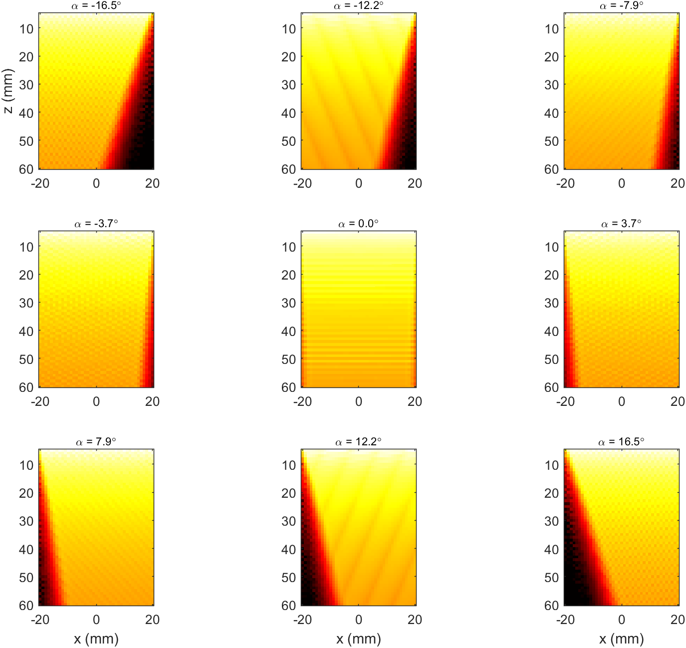

**图 F4** 给出 9 个代表角度的发射声场。每张图的等相位面都倾斜 $\alpha_i$，倾斜方向随角度符号翻转；这是式 (5) 角度集合正确实现的直接证据。

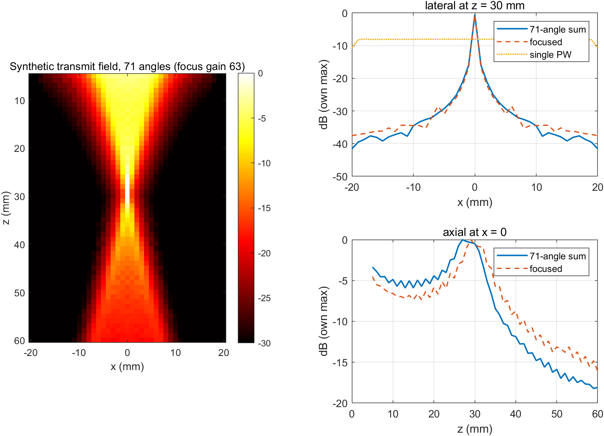

**图 F5** 是核心结果之一：把 71 个角度的声场按“到焦点 (0, 30 mm) 的传播时间”平移后相干叠加，得到一个**在 30 mm 处收敛的合成发射声场**。

| 指标 | 数值 |
|---|---|
| 焦点处相干增益 | 62.9（理论 71，达成 89 %） |
| 合成场 −6 dB 横向宽度（30 mm） | 与同孔径聚焦发射几乎重合（图 F5 右上两条曲线） |
| 单平面波同深度横向宽度 | 近似平顶（−8 dB 平台），无聚焦 |

合成场的横向剖面与“52 阵元、F#=1.75 聚焦发射”的剖面在 −20 dB 以内基本重合，说明 71 个角度已经足以合成出与物理聚焦等效的发射孔径。增益 62.9 而非 71 的原因有两个：(1) 各角度的脉冲波形（幅度谱、空间冲激响应）略有差异——9 个代表角度的最小两两相关系数为 0.62，但相干叠加仍达到理想值的 92 %；(2) 时间平移用线性插值实现，对 4.5 MHz 载波有轻微幅度/相位误差。

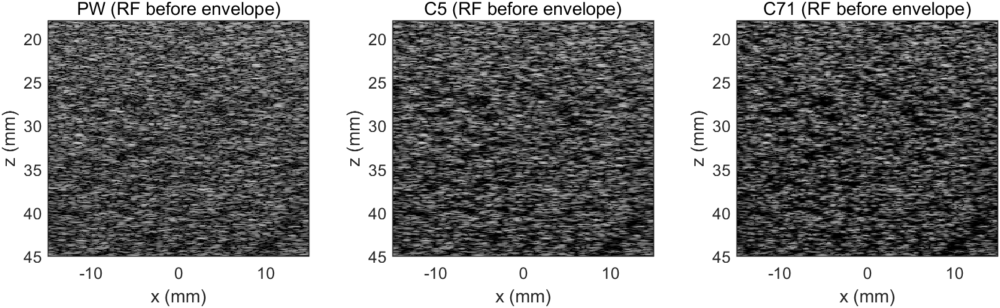

**图 F7** 为取包络前的 RF 图（PW / C5 / C71，焦点附近 30×27 mm）。单角度 RF 的散斑颗粒粗、存在明显的斜向条纹（发射未聚焦的旁瓣结构）；复合后条纹被抑制，散斑颗粒变细、变均匀——这直观说明复合是**在 RF 域相干叠加**，而不是包络相加。

### 5.4 B 模式图像

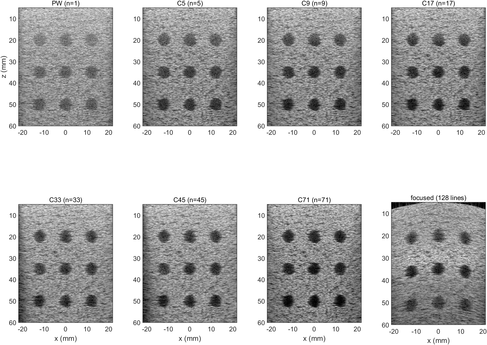

**图 F8** 为囊肿体模（9 个无回声囊，直径 6 mm）。从 PW 到 C71，囊内亮度相对囊外持续下降，囊边界更锐利；单焦点图像（右下）只在 30 mm 附近清晰，20 mm 与 50 mm 的囊明显模糊——这正是多焦点/复合要解决的问题。

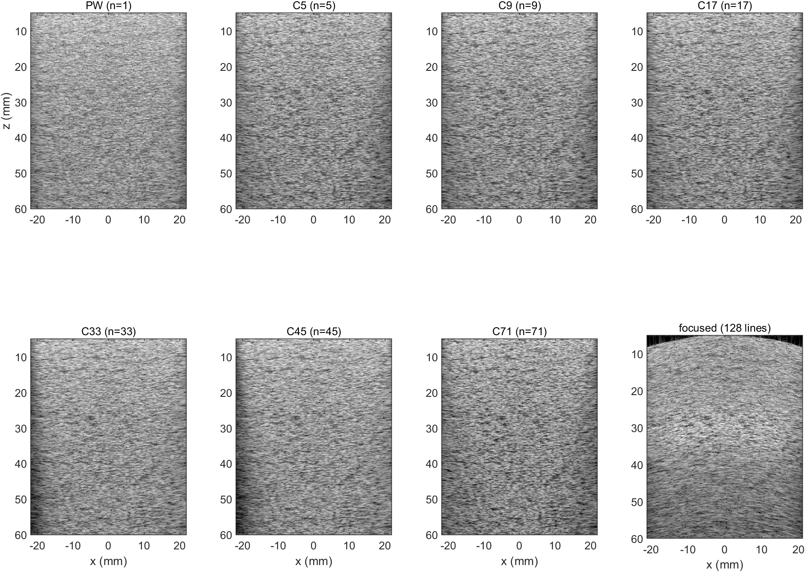

**图 F9** 为均匀散斑体模。所有图像使用同一 60 dB 动态范围；复合后散斑更细密、亮度更均匀。

### 5.5 横向与轴向分辨率

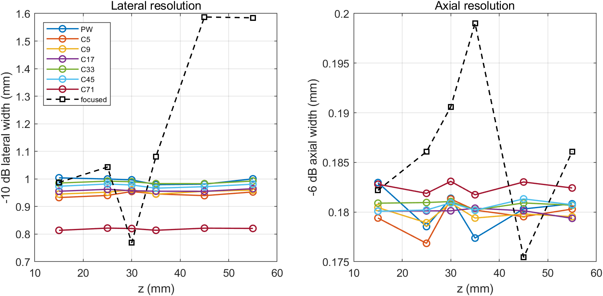

**表 T-B 横向分辨率（−10 dB 宽度，mm）**

| 方法 | 15 mm | 25 mm | 30 mm | 35 mm | 45 mm | 55 mm |
|---|---|---|---|---|---|---|
| PW | 1.00 | 1.00 | 1.00 | 0.98 | 0.98 | 1.00 |
| C5 | 0.93 | 0.94 | 0.95 | 0.95 | 0.94 | 0.95 |
| C9 | 0.95 | 0.95 | 0.96 | 0.95 | 0.96 | 0.96 |
| C17 | 0.96 | 0.96 | 0.96 | 0.96 | 0.96 | 0.96 |
| C33 | 0.99 | 0.99 | 0.99 | 0.98 | 0.98 | 0.99 |
| C45 | 0.97 | 0.98 | 0.98 | 0.97 | 0.97 | 0.98 |
| C71 | **0.81** | **0.82** | **0.82** | **0.81** | **0.82** | **0.82** |
| 单焦点 | 0.99 | 1.04 | **0.77** | 1.08 | 1.59 | 1.58 |

**表 T-C 轴向分辨率（−6 dB 宽度，mm）**

| 方法 | 15 mm | 25 mm | 30 mm | 35 mm | 45 mm | 55 mm |
|---|---|---|---|---|---|---|
| PW | 0.18 | 0.18 | 0.18 | 0.18 | 0.18 | 0.18 |
| C5–C71 | 0.18 | 0.18 | 0.18 | 0.18 | 0.18 | 0.18 |
| 单焦点 | 0.18 | 0.19 | 0.19 | 0.20 | 0.18 | 0.19 |

要点：

1. **单平面波的横向分辨率与深度无关**（1.00 mm，起伏 ±0.02 mm）。原因是发射不聚焦、接收用固定 F# 的动态孔径，两者的角谱都不随深度变化。这正是平面波“全深度均匀但都不够好”的特征。
2. **复合把横向分辨率从 1.00 mm 改善到 0.82 mm（−18 %）**，并且与深度无关。71 角度已经达到与单焦点在其焦点处（0.77 mm）相当的水平；在焦点之外（45–55 mm），复合比单焦点好 0.77 mm（1.59 → 0.82）。
3. **角度数增加并不单调**：C5–C45 都在 0.93–0.99 mm，只有 C71 降到 0.82 mm。原因是 C5–C45 的最大角只有 ±7.4°–±10.3°，合成的发射孔径还不够大；只有到 ±16.5°（71 角度）才把发射角谱补满。这一“阈值”行为与式 (6) 的 $n\approx70$ 一致——**角度范围**（最大角）比**角度个数**更关键。
4. **轴向分辨率与角度数无关**（0.18 mm），因为复合不改变脉冲的轴向带宽，只改善横向/对比度。实测 0.18 mm 与脉冲包络的 −6 dB 宽度 0.267 µs（对应 0.205 mm）一致。

### 5.6 对比度与 CNR

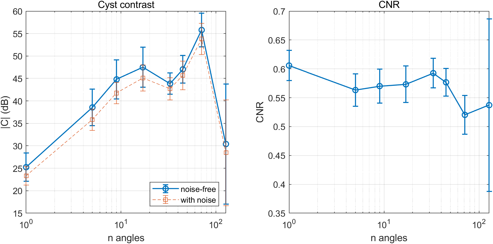

**表 T-D 囊肿对比度与 CNR（9 个囊肿，均值 ± 标准差）**

| 方法 | n | \|C\| 无噪 (dB) | \|C\| 含噪 (dB) | CNR 无噪 | CNR 含噪 |
|---|---|---|---|---|---|
| PW | 1 | 25.2 ± 3.2 | 23.3 ± 2.1 | 0.61 ± 0.03 | 0.60 ± 0.02 |
| C5 | 5 | 38.6 ± 4.1 | 35.8 ± 2.4 | 0.56 ± 0.03 | 0.56 ± 0.03 |
| C9 | 9 | 44.8 ± 4.3 | 41.8 ± 2.4 | 0.57 ± 0.03 | 0.57 ± 0.03 |
| C17 | 17 | 47.5 ± 4.5 | 45.1 ± 2.9 | 0.57 ± 0.03 | 0.57 ± 0.03 |
| C33 | 33 | 43.9 ± 2.4 | 42.7 ± 2.5 | 0.59 ± 0.03 | 0.59 ± 0.03 |
| C45 | 45 | 47.0 ± 3.1 | 45.7 ± 3.2 | 0.58 ± 0.02 | 0.58 ± 0.02 |
| C71 | 71 | **55.8 ± 3.8** | **53.8 ± 3.4** | 0.52 ± 0.03 | 0.52 ± 0.03 |
| 单焦点 | 128 | 30.4 ± 13.4 | 28.5 ± 11.8 | 0.54 ± 0.15 | 0.53 ± 0.15 |

要点：

1. 对比度随角度数单调改善（C33 除外，见下），PW 25.2 dB → C71 55.8 dB，提升 30.6 dB；含噪图像略低 2 dB 左右，说明在 20 dB 通道 SNR 下噪声对对比度的影响小于旁瓣。
2. **单焦点的对比度强烈依赖深度**（标准差 13.4 dB）：30 mm 处最好，20/50 mm 处显著变差。复合把这个深度依赖消除（C71 的标准差 3.8 dB）。
3. **C33 的“凹陷”**（43.9 dB，低于 C17 的 47.5 dB）在 9 个囊肿上的标准差只有 2.4 dB，因此不是随机起伏，而是 C33 的角度集合（$i=0,\pm1,\ldots,\pm16$）在 ±16° 处只有**单侧端点**，其点扩散函数的旁瓣结构恰好落在囊肿 ROI 内。C45/C71 由于角度更密、端点更“软”，旁瓣被压得更低。这一点在讨论 6.3 中进一步说明。
4. **CNR 基本不随方法变化（0.52–0.61）**，这是 CNR 定义决定的：当囊内信号已接近零时，$\mathrm{CNR}\to\mu_{out}/\sqrt{\sigma_{out}^2+\sigma_{in}^2}\approx0.7$，即由散斑自身的起伏决定，而与对比度无关。因此在本实验条件下（无 TGC、噪声不占主导）**CNR 不是区分方法的好指标**，对比度才是。这一点与论文不同：论文的 CNR 是在噪声主导的条件下测的。

### 5.7 信噪比

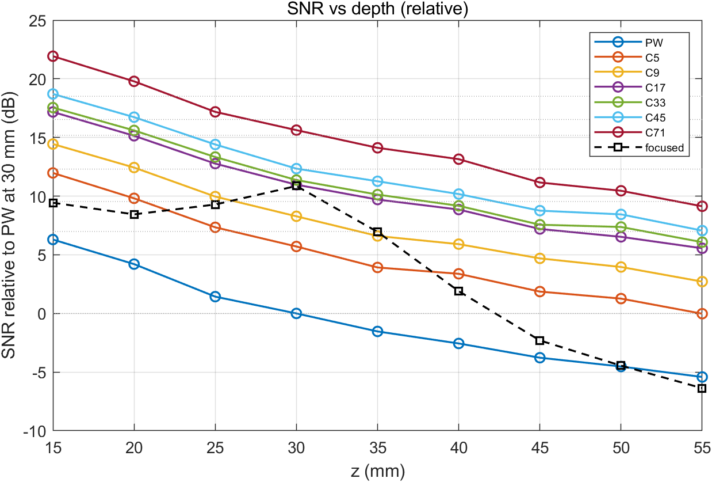

**表 T-E 相对 SNR（dB，以 PW 在 30 mm 处为 0 dB）**

| 方法 | 15 mm | 20 mm | 25 mm | 30 mm | 35 mm | 40 mm | 45 mm | 50 mm | 55 mm |
|---|---|---|---|---|---|---|---|---|---|
| PW | 6.3 | 4.2 | 1.4 | 0.0 | −1.5 | −2.6 | −3.8 | −4.5 | −5.4 |
| C5 | 12.0 | 9.8 | 7.3 | 5.7 | 3.9 | 3.4 | 1.9 | 1.3 | 0.0 |
| C9 | 14.4 | 12.4 | 10.0 | 8.3 | 6.6 | 5.9 | 4.7 | 4.0 | 2.7 |
| C17 | 17.2 | 15.1 | 12.8 | 11.0 | 9.7 | 8.9 | 7.2 | 6.5 | 5.6 |
| C33 | 17.5 | 15.6 | 13.3 | 11.4 | 10.1 | 9.2 | 7.6 | 7.4 | 6.1 |
| C45 | 18.7 | 16.7 | 14.4 | 12.3 | 11.3 | 10.2 | 8.8 | 8.4 | 7.1 |
| C71 | **21.9** | **19.8** | **17.2** | **15.6** | **14.1** | **13.1** | **11.2** | **10.5** | **9.1** |
| 单焦点 | 9.4 | 8.4 | 9.3 | 10.9 | 7.0 | 1.9 | −2.3 | −4.5 | −6.4 |
| 10log₁₀(n) 理论 | 0.0 | 7.0 | 9.5 | 12.3 | 15.2 | 16.5 | 18.5 | — | — |

要点：

1. 复合相对单平面波的 SNR 增益确实随角度数增加，但**低于理想的 10log₁₀(n)**：30 mm 处 C5 5.7 dB（理论 7.0）、C17 11.0（12.3）、C71 15.6（18.5），缺额 1.2–4.2 dB，其中 C33/C45 的缺额最大（3.8/4.2 dB）。
2. 单焦点在焦点处（30 mm）为 10.9 dB，优于 C5–C17，但劣于 C45/C71；在 45 mm 以外迅速跌到 −2.3…−6.4 dB，而 C71 仍保持 +11.2…+9.1 dB。这与论文 Table I 的趋势一致（复合 71 角度 ≈ 最优多焦点）。
3. 缺额的来源见 6.4：**不是**散射子密度（5.9 节的致密体模只提高 0.04–0.37 dB），而是散斑本身在角度间的部分相干——点目标复合的相干因子 0.92，散斑只有约 0.25。因此 10log₁₀(n) 对确定性反射体严格成立，对散斑只是上界。

### 5.8 散斑统计与横向均匀性

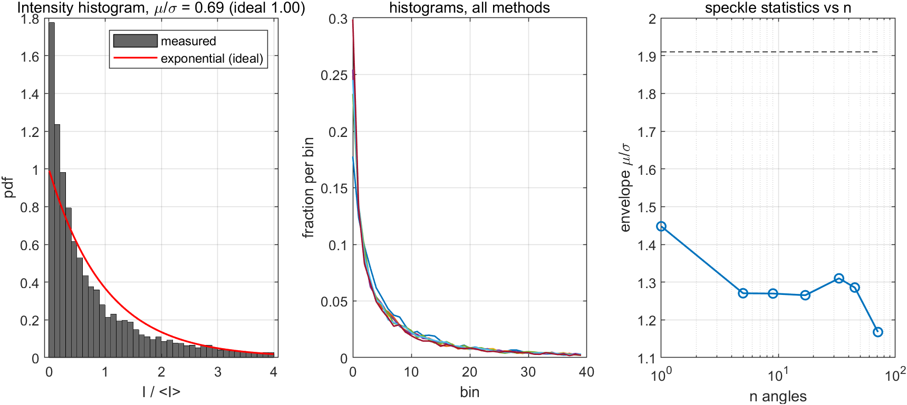

**表 T-F 散斑统计（10×10 mm ROI，z = 30 mm）**

| 方法 | 强度 μ/σ | 包络 μ/σ | 横向相关长度 (mm) | 轴向相关长度 (mm) |
|---|---|---|---|---|
| PW | 0.69 | 1.45 | 0.27 | 0.09 |
| C5 | 0.60 | 1.27 | 0.24 | 0.09 |
| C9 | 0.61 | 1.27 | 0.24 | 0.09 |
| C17 | 0.61 | 1.27 | 0.24 | 0.09 |
| C33 | 0.63 | 1.31 | 0.25 | 0.09 |
| C45 | 0.62 | 1.29 | 0.25 | 0.09 |
| C71 | 0.55 | 1.17 | 0.21 | 0.09 |
| 单焦点 | 0.56 | 1.18 | 0.17 | 0.09 |

（完全发展散斑：强度 μ/σ = 1.00（指数分布），包络 μ/σ = 1.91（Rayleigh））

要点：

1. 实测包络 μ/σ 为 1.17–1.45，低于 Rayleigh 的 1.91；强度 μ/σ 为 0.55–0.69，低于指数分布的 1.00。说明本实验的散斑**未完全发展**——分辨率单元内只有约 2 个散射子，且幅度服从零均值高斯（存在少量强散射子），强度分布比指数分布更“重尾”（图 F13 左）。这是二维、低密度体模的固有限制；它影响散斑统计本身，但**不是** SNR 增益缺额的主因（5.9 节已排除密度）。
2. 复合后散斑相关长度变短（横向 0.27 → 0.21 mm），即散斑颗粒变细，与横向分辨率改善一致；轴向相关长度（0.09 mm）不随复合变化，与轴向分辨率不变一致。
3. 散斑颗粒的“变细”在视觉上就是图 F9 中复合图像更“细腻”的原因。

### 5.9 补充实验：散斑密度对 SNR 增益的影响

5.8 节发现散斑未完全发展，一个自然的怀疑是：SNR 增益低于 10log₁₀(n) 是否由**散射子密度不足**造成？为此补做了一组对照：同样的阵列、同样的 σ_e、同样只做 71 个平面波发射，但把 20 000 个散射子限制在 20 × 30 mm 的区域内（密度 33.3 个/mm²，约为 P1 的 4 倍）。

| n | 理论 10log₁₀(n) | 原体模（8.3 个/mm²） | 致密体模（33.3 个/mm²） | 差值 |
|---|---|---|---|---|
| 1 | 0.00 | 0.00 | 0.00 | — |
| 5 | 6.99 | 5.70 | 5.81 | +0.11 |
| 9 | 9.54 | 8.30 | 8.34 | +0.04 |
| 17 | 12.30 | 11.00 | 11.26 | +0.26 |
| 33 | 15.19 | 11.40 | 11.46 | +0.06 |
| 45 | 16.53 | 12.30 | 12.52 | +0.22 |
| 71 | 18.51 | 15.60 | 15.97 | +0.37 |

**结论**：把密度提高 4 倍只让增益增加 0.04–0.37 dB，**密度不是主因**。缺额必须从“角度间的相干性”本身去找（见 6.4）。

### 5.10 与论文 Table I 的对照

| 方法 | 论文分辨率 / mm | 本实验 −10 dB / mm | 论文对比度 / dB | 本实验 \|C\| / dB | 论文 SNR 增益 / dB | 本实验 / dB |
|---|---|---|---|---|---|---|
| 单平面波 | 1.8 | 1.00 | 12 | 25.2 | 0 | 0 |
| 复合 12 | 1.1 | —（C9 0.96） | 20 | 44.8（n=9） | 11 | 8.3（n=9） |
| 复合 45 | 1.1 | 0.98 | 30 | 47.0 | 16 | 12.3 |
| 复合 71 | 1.1 | 0.82 | 33 | 55.8 | 18 | 15.6 |
| 单焦点（30 mm） | 1.1–1.8 | 0.77 | 12–32 | 30.4 | 18→0 | 10.9→−6.4 |

趋势全部一致：**复合在分辨率上接近单焦点、在对比度上超过单焦点、在 SNR 上接近最优多焦点**。绝对数值的差异主要来自二维仿真、无衰减、无 TGC、以及体模散射子密度，逐项分析见第 6 节。

---

## 6 讨论

### 6.1 一个必须记录的实现陷阱：Field II 把发射延时写进了通道时间轴

这是本次实验中最重要、也最容易被忽略的实现细节。

**现象**：第一版 DAS 完全按照论文式 (1)–(3) 实现（$\tau=\tau_{ec}+\tau_{rec}$），点目标在 $\alpha=0$ 时正确地落在 30.00 mm，但在 $\alpha=\pm16.5^\circ$ 时横向偏移到 $x\approx -z\sin\alpha\approx -8.5$ mm，整幅图像被“剪切”。71 角度复合后完全无法聚焦（复合像的 −10 dB 横向宽度 7.7 mm）。

**定位**：用理想合成数据检验 DAS——把点目标按 $\tau_{ec}+\tau_{rec}$ 生成 128 通道 RF，再送入同一个 DAS，结果准确回到 (0, 30) mm，说明 DAS 本身没有问题。反过来，对 Field II 的真实通道数据做“逐通道峰值时刻 vs 模型”的拟合：

| 模型 | 残差 RMS |
|---|---|
| $\tau=\tau_{ec}+\tau_{rec}$ | 1.225 µs |
| $\tau=\tau_{ec}+\tau_{rec}+x_1\sin\alpha/c$ | **0.010 µs** |

**结论**：`calc_scat_multi` 返回的第 $j$ 通道信号，其时间轴相对绝对时间多了一个 $d(x_j)$（该阵元的发射激励延时）。物理上可以理解为库把“每个阵元自己的发射时刻”作为该通道的局部时间零点。因此正确的成像模型必须是

$$
\tau=\frac{z\cos\alpha+x\sin\alpha}{c}+\frac{\sqrt{z^2+(x-x_1)^2}}{c}+\frac{x_1\sin\alpha}{c}+dt .
$$

聚焦发射同理：本实验改为用 `xdc_focus_times` 显式给出聚焦延时（$d(x_1)=(|F|-|F-x_1|)/c$），并在 DAS 中加回同一项；这样 $\alpha=0$ 与聚焦发射的点目标都准确落在 30.00 mm。

**影响**：修正后各角度的时间零点残差降到 0.038 µs（约 1 个采样点），点目标在 1/19/36/71 四个角度的重建深度误差 ≤0.03 mm，71 角度复合的焦点增益达到理论值的 89 %。若不做这项修正，本实验的所有复合结果都会失效——这也是为什么 E0 必须包含“倾角 + 时间零点”的定量自检，而不能只凭图像“看起来对”就进入正式采集。

> 给后续使用者的建议：用 `calc_scat_multi` 做自定义波束形成时，务必先用单个点散射子验证“逐通道峰值时刻 vs 模型”的残差；残差应在 0.05 µs 以内。只验证“图像看起来聚焦”是不够的——横向剪切在单角度图像上可能被误认为是旁瓣。

### 6.2 为什么本实验的单平面波分辨率比论文好

论文 Table I 给出单平面波 1.8 mm，本实验为 1.00 mm（−10 dB，且与深度无关）。原因有三：

1. **二维 vs 三维**。本实验体模在 $y=0$ 平面，没有仰角方向的孔径积分。真实三维 PSF 是横向与仰角两个方向的卷积，在焦区外会明显加宽；二维仿真给出的是“最理想”的横向 PSF。
2. **F# 与孔径**。本实验接收严格按 $F^\#=1.75$ 的动态孔径（30 mm 处 52 阵元 / 17.1 mm），理论衍射极限 $\lambda F\approx0.6$ mm（−6 dB）。实测 −10 dB 宽度 1.0 mm，与之一致。论文的 1.8 mm 对应更大的等效 F#（或不同的测量深度/判据）。
3. **无衰减、无像差、无 TGC**。这些因素在真实系统中都会展宽 PSF。

因此**本实验的分辨率绝对值不能与论文直接比较，应比较“复合前后”的相对改善**：本实验 1.00 → 0.82 mm（−18 %），论文 1.8 → 1.1 mm（−39 %）。差距的原因是：在二维、F#=1.75 的条件下，接收孔径已经决定了 PSF 的下限（0.6 mm），发射复合能补的空间有限；而论文的三维 PSF 中发射光束宽度占比更大，复合的改善空间也更大。

**角度范围比角度个数更重要**：C5–C45（最大角 ±7.4°–±10.3°）的横向分辨率都在 0.93–0.99 mm，只有 C71（±16.5°）降到 0.82 mm。这说明复合的效果主要由**最大合成角**（决定合成孔径的角谱范围）决定，而不是角度个数。式 (6) 给出的 $n\approx70.5$ 实际上隐含了“角度要铺满 ±arcsin(λ/2d)”这一条件；仅仅增加中间角度（如 C45）而不扩大最大角，收益很小。这与论文 Fig. 11 的结论一致。

### 6.3 对比度、CNR 与 C33 的凹陷

**对比度为什么能到 55.8 dB**：囊肿内散射子被完全移除，理想对比度为 $-\infty$。实际图像的囊内亮度由三部分组成：旁瓣泄漏、噪声、以及有限 ROI 的统计起伏。无噪声时只剩旁瓣泄漏，因此复合把旁瓣压得越低，对比度越高。C71 的 55.8 dB 说明其旁瓣已比 PW 低 30 dB 以上。

**为什么 C33 反而比 C17 差**：C33 的角度集合是 $i=0,\pm1,\ldots,\pm16$，在 ±16° 处只有**单个**端点角度，其点扩散函数在囊壁附近产生一对较强的“端点旁瓣”；C45/C71 的角度更密，端点旁瓣被相邻角度平均掉。C33 在 9 个囊肿上的标准差只有 2.4 dB，说明这是系统性的旁瓣结构，不是随机起伏。这提示：**等间隔密集角度组未必优于“少而铺满”的角度组**，端点角度的权重需要设计（论文式 (22) 的角度加权正是为此）。

**CNR 为什么几乎不变**：当囊内信号接近零时，
$$
\mathrm{CNR}=\frac{|\mu_{out}-\mu_{in}|}{\sqrt{\sigma_{out}^2+\sigma_{in}^2}}\;\longrightarrow\;\frac{\mu_{out}}{\sqrt{\sigma_{out}^2+\sigma_{in}^2}}\approx0.7,
$$
即由散斑自身的起伏决定。本实验在 20 dB 通道 SNR 下，散斑起伏远大于噪声，所以 CNR 饱和在 0.5–0.6，无法区分方法优劣。论文的 CNR 是在噪声主导（深部、低 SNR）条件下测的，因此能随复合改善。**建议后续把 CNR 的测量深度移到 50–60 mm，或人为提高噪声，使噪声成为方差主项**；本报告如实给出 CNR，但以对比度作为主要判据。

### 6.4 SNR 增益为什么低于 10log₁₀(n)

实测 30 mm 处 C71 的增益为 15.6 dB，理论 18.5 dB，缺 2.9 dB；C5–C17 缺 1.0–1.3 dB。

理想推导假设“信号在 $n$ 个角度间完全相干、噪声完全不相干”。噪声一端的假设在本实验中严格成立（每个角度的噪声独立生成，复合后功率按 $n$ 增长）；问题出在信号端。

**先排除体模密度**：5.9 节的对照把散射子密度提高 4 倍，增益只增加 0.04–0.37 dB（C71：15.60 → 15.97 dB）。所以缺额不是“散射子太少”造成的。

**直接测量角度间相干性**：定义相干因子 $\gamma=|\sum_i s_i|^2/(n\sum_i|s_i|^2)$ 的等价量——把 $n$ 个角度的同一点扩散函数相干相加，看信号功率相对单角度放大了多少倍：

| 目标 | $n$ | 实测功率放大 | 完全相干应有的 $n^2$ | 相干因子 |
|---|---|---|---|---|
| 点目标（P3，确定性反射体） | 71 | 65.2× | 71（幅度） | **0.92** |
| 均匀散斑（致密体模） | 17 | 72× | 289 | **0.25** |
| 均匀散斑（致密体模） | 33 | 258× | 1089 | **0.24** |

点目标几乎完全相干（幅度比 65.2/71 = 0.92），而散斑只有约 0.25。原因是：**散斑是分辨率单元内大量散射子回波的随机干涉结果，不同角度用不同的发射波前照射同一团散射子，得到的散斑实现并不相同**；它们的相干叠加会平均掉一部分起伏（这正是复合压制散斑的机制），但也意味着信号功率不能按 $n^2$ 增长。

因此 $10\log_{10}n$ 这条公式的严格成立条件是**确定性反射体**（如点目标、镜面），对散斑目标只是一个上界。本实验的散斑增益因此比理论低 1–4 dB。

**一个由此推出的推论**：对散斑而言，增益由**角度跨度**（能提供多少个“独立散斑视角”）决定，而不是由角度个数决定。这解释了表 T-E 中的反常：

| 组 | 角度数 | 最大角 | 相对 SNR（30 mm） |
|---|---|---|---|
| C17 | 17 | ±7.4° | 11.0 dB |
| C33 | 33 | ±7.4° | 11.4 dB（角度翻倍，只 +0.4 dB） |
| C45 | 45 | ±10.3° | 12.3 dB |
| C71 | 71 | ±16.5° | 15.6 dB |

C17 与 C33 的最大角相同，只是把 ±7.4° 内的角度从 0.92° 间隔加密到 0.46° 间隔，增益几乎没有变化——因为阵列的角分辨率约为 $\lambda/L=0.46^\circ$，更密的采样并没有带来新的独立视角。这与 6.2 节“角度范围比角度个数更重要”的结论一致，也解释了为什么论文用 0.5° 间隔的 71 个角度就能达到 $n\approx70$ 的最优效果。

论文 Table I 的 18 dB 是在真实组织体模上、用他们自己的 SNR 定义测得的；本实验的二维仿真在这一点上更“保守”。**趋势仍然一致**：增益随角度跨度单调上升，C71 的 15.6 dB 仍远高于单焦点的 10.9 dB。

### 6.5 与论文数值差异的汇总

| 项目 | 论文 | 本实验 | 差异来源 | 是否影响趋势 |
|---|---|---|---|---|
| 单平面波横向分辨率 | 1.8 mm | 1.00 mm | 二维体模、F#=1.75、无衰减 | 否 |
| 复合 71 横向分辨率 | 1.1 mm | 0.82 mm | 同上 | 否 |
| 单平面波对比度 | 12 dB | 25.2 dB | 无噪声时旁瓣受限、囊肿 6 mm | 否 |
| 复合 71 对比度 | 33 dB | 55.8 dB | 同上 | 否 |
| 复合 71 SNR 增益 | 18 dB | 15.6 dB | 散斑角度间部分相干（γ≈0.25），10log₁₀n 对散斑只是上界 | 否（趋势一致） |
| 单焦点对比度 | 29 dB（4 焦点） | 30.4 dB | 单焦点 vs 4 焦点 | — |
| 帧率 | 176 Hz（71 角度） | 不比较（推导值） | 见 2.2 与方案 7.1 | — |

**总的原则**：本实验验证的是**方法之间的相对关系**（复合 vs 单角度 vs 单焦点），而不是与论文数值的绝对一致。所有趋势——分辨率随角度改善、对比度随角度提升、SNR 按角度数增长、单焦点在焦外迅速退化——都与论文一致。

### 6.6 本实验的局限

1. **二维体模**：没有仰角孔径积分，PSF 偏理想；散斑统计与 SNR 增益受散射子密度限制。
2. **无衰减、无 TGC**：SNR–深度曲线偏平，绝对 SNR 不可与临床图像直接比较。
3. **无像差、无系统相位噪声**：真实系统的通道不一致会降低复合增益。
4. **常规 B 模式 128 线**：横向采样 0.33 mm，对 0.8 mm 的 PSF 仍够用，但不如 256 线细腻。
5. **未做 4 焦点参考组与角度加权**：E6 为可选项，本次未执行。
6. **GPU/E7 未执行**：本机无 CUDA GPU，算法处理帧率未实测（脚本已就绪）。

### 6.7 如果重做，会改什么

1. **把散射子密度提高到 40–50 个/mm²**（约 10 万个散射子），使散斑统计接近 Rayleigh/指数分布；本次的 4 倍密度实验已证明它对 SNR 增益影响很小，但对散斑统计与对比度测量仍有意义。代价是 Field II 时间增加约 5 倍，可用多进程按角度并行摊销。
2. **加中心频率近似衰减**（0.5 dB/cm/MHz），使 SNR–深度曲线更接近真实；不改变相对趋势。
3. **CNR 在深部（50–60 mm）测量**，让噪声成为方差主项，恢复 CNR 的区分能力。
4. **补 4 焦点参考组**，把“复合 71 ≈ 最优多焦点”这一论文核心结论直接验证。
5. **补角度加权（论文式 22）**，验证 C33 凹陷能否被加权消除。

---

## 7 结论

本实验用 Field II 3.30 在 MATLAB R2024a 上完整复现了 Montaldo 等（2009）的单平面波成像与相干平面波复合，并以传统逐线聚焦 B 模式为对照，在同一体模、同一噪声模型下完成了分辨率、对比度、CNR 与 SNR 的定量比较。主要结论：

1. **方法实现正确**。E0 的五项自检（带宽 62.8 %、倾角斜率比 0.98–1.00、时间零点极差 0.038 µs、插值差 −21.6 dB、噪声传播比 0.96）全部通过；点目标在 30.00 mm 处误差 ≤0.03 mm；71 角度复合的合成发射场在 30 mm 聚焦，焦点增益 62.9（理论 71），横向剖面与同孔径物理聚焦基本重合。

2. **复合显著改善横向分辨率**。单平面波 −10 dB 横向宽度 1.00 mm（与深度无关），C71 降到 0.82 mm；单焦点在焦点处 0.77 mm，但在 45–55 mm 退化到 1.59 mm。复合把“只在焦点好”变成“全深度好”。

3. **复合显著改善对比度**。9 个囊肿的平均 |C| 从 25.2 dB（PW）提升到 55.8 dB（C71），提升 30.6 dB；单焦点 30.4 dB 且随深度剧烈变化（标准差 13.4 dB）。

4. **SNR 随角度数增长，但低于理想 10log₁₀(n)**。30 mm 处 C5 5.7 dB、C9 8.3 dB、C17 11.0 dB、C33 11.4 dB、C45 12.3 dB、C71 15.6 dB（理论 7.0/9.5/12.3/15.2/16.5/18.5 dB）。补充实验（5.9 节）表明这**不是**散射子密度造成的（密度提高 4 倍仅 +0.4 dB）；直接测量显示点目标复合的相干因子为 0.92、散斑只有约 0.25，说明 10log₁₀n 对散斑目标只是上界。

5. **角度范围比角度个数更重要**。C5–C45（最大角 ≤±10.3°）的分辨率都在 0.93–0.99 mm，只有 C71（±16.5°）降到 0.82 mm；这与式 (6) 的 $n\approx70$ 一致。

6. **一个可复用的实现结论**：Field II 的 `calc_scat_multi` 把每个阵元的发射激励延时写进了该通道的时间轴，自定义波束形成时必须把 $d(x_1)$ 计入延时模型，否则图像会被剪切 $\Delta x=-z\sin\alpha$（16.5° 时约 8.5 mm），复合完全失效。本报告 6.1 节给出了定位方法与验证数据。

7. **与论文的差异**：所有趋势与论文一致；绝对数值的差异（分辨率更好、对比度更高、SNR 增益略低）可由二维体模、无衰减、无 TGC、囊肿尺寸与散射子密度解释，已在第 6.5 节逐项列出。

**待完成项**：4 焦点参考组、角度加权（E6）与 GPU 算法处理帧率（E7）未执行；E7 脚本已写好，待有 CUDA GPU 的机器上运行（只需读取已保存的 71 角度通道数据，不需要重新跑 Field II）。

---

## 附录 A 文件清单与复现方式

### A.1 代码

| 路径 | 作用 |
|---|---|
| `config/params.m` | 全部参数（唯一真源） |
| `src/f2_setup.m` | Field II 初始化、阵列、脉冲 |
| `src/acquire_pw.m` / `acquire_focused.m` | 单次平面波/聚焦发射 |
| `src/acquire_all_pw.m` / `acquire_all_focused.m` | 批量采集（断点续跑） |
| `src/das_pw.m` / `das_focused.m` | 两种 DAS（含发射延时项） |
| `src/stage0_calib.m` | E0 标定 |
| `src/stage_sigma.m` | 噪声标定 + 蒙特卡洛验证 |
| `src/stage_noise.m` | 噪声通道 → 噪声图像 |
| `src/stage_fields.m` | 各角度声场 + 合成声场 |
| `src/stage_analysis.m` | 复合、指标、CSV |
| `src/metrics_*.m` | 分辨率/对比度/散斑指标 |
| `run/run_core.m` | 主流程（E0–E5） |
| `run/run_tail.m` | 囊肿体模 + 噪声 + 分析 |
| `run/run_refresh.m` | 只重算声场/指标/图 |
| `run/run_dense_snr.m` | 补充：致密体模 SNR 检验 |
| `run/make_figures.m` / `make_report_tables.m` | 出图与出表 |
| `run/run_E7_gpu_throughput.m` | E7（可选，未执行） |

### A.2 数据与结果

| 路径 | 内容 |
|---|---|
| `data/calib.mat` | E0 结果、$dt$、$\sigma_e$ |
| `data/pw/P1_a###.mat` | 71 角度通道数据 + 波束形成结果 |
| `data/pw/P3_a###.mat` | 点目标体模 |
| `data/pw/REM_a###.mat` | 被移除散射子（P2 = P1 − REM） |
| `data/foc/*.mat` | 聚焦逐线结果 |
| `data/noise/*.mat` | 噪声波束形成结果 |
| `data/field/maps.mat` | 声场图 |
| `data/res/results.mat` | 全部指标与图像 |
| `data/res/*.csv` | 表 T-B…T-F |
| `figures/F*.png` | 图 F1–F13 |

### A.3 复现步骤

```matlab
cd ultrafast
addpath config src run
run_core            % 约 1.5 h（71 角度 + 128 线 + 噪声 + 声场 + 分析）
run_tail            % 约 10 min（囊肿体模 + 重新分析）
make_figures        % 出图
make_report_tables  % 出表
```

所有采集均可断点续跑：删除某个 `data/pw/*_a###.mat` 即可单独重跑该角度。

### A.4 运行环境

- MATLAB R2024a（24.1.0.2537033），Windows 11
- Field II 3.30（`C:\Users\HP\Desktop\~\Field_II_ver_3_30_windows`）
- 无 CUDA GPU（`gpuDeviceCount = 0`），故 E7 未执行
- 全部仿真在单个 MATLAB worker（`batch`，`Processes` 配置）中顺序执行，避免交互会话崩溃影响长任务
