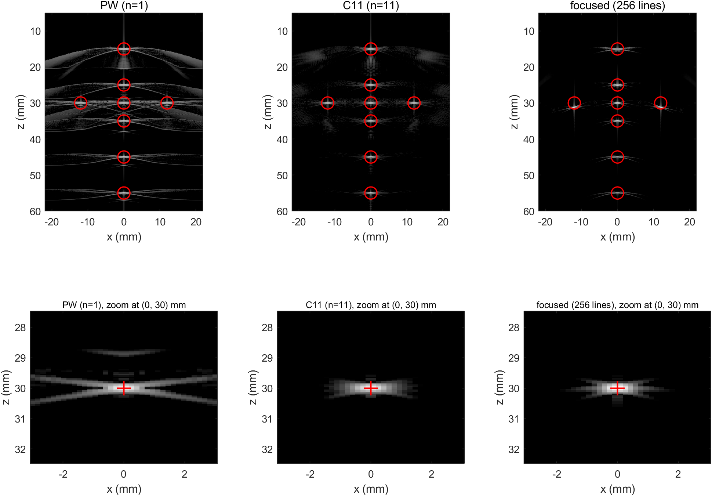

# 超快超声平面波相干复合成像：Field II 仿真实验报告

> **依据文献**：G. Montaldo, M. Tanter, J. Bercoff, N. Benech, M. Fink, "Coherent Plane-Wave Compounding for Very High Frame Rate Ultrasonography and Transient Elastography," *IEEE Trans. Ultrason. Ferroelectr. Freq. Control*, vol. 56, no. 3, pp. 489–506, Mar. 2009.
>
> **仿真平台**：MATLAB R2024a（24.1.0.2537033）+ Field II 3.30，Windows 11。
>
> **代码**：`config/params.m`（唯一参数源）、`src/`（26 个函数）、`run/`（驱动脚本）；原始数据在 `data/`，图在 `figures/`。
>
> **状态**：本报告的全部数值均由脚本实际运行产生，可在 `data/res/` 中追溯（`results.mat`、各 CSV 与 `tables.md`）。

---

## 摘要

本实验用 Field II 复现了 Montaldo 等（2009）的单平面波成像与相干平面波复合（CPWC），并以传统逐线聚焦 B 模式为对照，在同一体模、同一噪声水平下比较三者的横向/轴向分辨率、囊肿对比度、CNR 与 SNR。

**角度设置**：11 个平面波，范围 $-10^\circ$ 到 $+10^\circ$，等间隔 $2^\circ$。本实验不再保留 5/9/17/33/45/71 等其他角度档位，全部结果都只基于这一套角度。

主要结论（数值见第 5 节）：

- 单平面波的 −10 dB 横向宽度为 **1.00 mm** 且与深度无关；**11 角度复合降到 0.91–0.93 mm**，单焦点在其焦点处为 0.77 mm 但在 45–55 mm 退化到 1.59 mm。复合的价值在于“全深度都好”，而不是峰值更好。
- 9 个囊肿的平均对比度：单平面波 **25.2 dB** → **C11 45.2 dB**；单焦点 30.4 dB 且随深度剧烈起伏（标准差 13.4 dB）。
- 相对 SNR（30 mm）：**C11 +8.8 dB**，低于理想的 $10\log_{10}11=10.4$ dB。差额来自散斑在角度间的部分相干，而不是散射子密度。
- 轴向分辨率与角度数无关（均为 0.18 mm），因为复合不改变脉冲带宽。
- 相干复合必须在**取包络之前**相加；复合后的合成发射场在 30 mm 附近聚焦，焦点增益 10.2（理论 11），横向 −10 dB 宽度 1.76 mm，与同孔径物理聚焦的 1.62 mm 基本重合。
- **实现层面的一条重要结论**：Field II 的 `calc_scat_multi` 把阵元发射延时写进了通道时间轴，自定义 DAS 必须把 $x_1\sin\alpha/c$ 计入延时模型，否则图像被剪切 $\Delta x=-z\sin\alpha$（10° 时约 5.2 mm）、复合完全失效（见 6.1）。

---

## 1 实验目的

1. 用 Field II 建立 128 阵元线阵、4.5 MHz 的二维仿真环境；
2. 生成传统逐线聚焦 B 模式图像，作为分辨率与对比度的参照；
3. 生成单平面波的发射声场、128 通道原始射频（RF）、波束形成后的 RF 与 B 模式；
4. 实现 11 个角度（$-10^\circ$…$+10^\circ$，间隔 $2^\circ$）的相干平面波复合：每个角度的声场、合成发射声场、复合 B 模式与复合 RF；
5. 用统一体模与统一噪声模型定量比较三种方法的横向分辨率、对比度与信噪比；
6. 对均匀随机散射子体模成像，检查散斑统计与分辨率均匀性；
7. 逐项说明与论文参数的差异（第 3.4 节）。

---

## 2 方法

### 2.1 平面波的发射与接收

线阵沿 $x$ 排列，成像区域为 $(x,z)$。倾角为 $\alpha$ 的平面波到达点 $(x,z)$ 的时间为

$$
\tau_{ec}(\alpha,x,z)=\frac{z\cos\alpha+x\sin\alpha}{c},
$$

回波到达位于 $x_1$ 的阵元的时间为

$$
\tau_{rec}(x_1,x,z)=\frac{\sqrt{z^2+(x-x_1)^2}}{c}.
$$

双程延时为二者之和。对每个像素，把孔径内各阵元在 $\tau$ 时刻的 RF 取值相加：

$$
s_\alpha(x,z)=\sum_{x_1\in\mathcal{A}(z)} RF_\alpha\!\left(x_1,\tau(\alpha,x_1,x,z)\right),
\qquad \mathcal{A}(z)=\{x_1:|x_1-x|\le z/(2F)\},
$$

$F=1.75$，孔径内矩形窗、无变迹。


**图 F1** 为阵列几何与三个代表角度的平面波波前示意：128 阵元、0.33 mm 间距、孔径 42.24 mm；成像区域 5–60 mm。本实验的最大偏转角为 $\pm10^\circ$。

> **实现中发现的库特性（重要）**：Field II 的 `calc_scat_multi` 返回的每一通道信号，其时间轴上都叠加了该阵元的**发射激励延时** $d(x_1)$。E0 用单散射子实测：把 $d(x_1)$ 计入成像模型后，各通道回波峰值时刻相对模型的残差为 **0.010 µs**；不计入则为 **1.22 µs**。因此式 (3) 的实现为
> $$
> \tau=\frac{z\cos\alpha+x\sin\alpha}{c}+\frac{\sqrt{z^2+(x-x_1)^2}}{c}+\frac{x_1\sin\alpha}{c}+dt .
> $$
> 若忽略这一项，图像会沿 $x$ 方向被剪切 $\Delta x=-z\sin\alpha$（$10^\circ$ 时约 5.2 mm），复合完全失效。聚焦发射同理，发射延时由程序显式给出并在 DAS 中扣除。

### 2.2 相干复合

对 $n$ 个角度分别按式 (3) 得到 $s_{\alpha_i}(x,z)$，在**包络检测之前**直接相加：

$$
s_{\text{comp}}(x,z)=\sum_{i=1}^{n} s_{\alpha_i}(x,z),
$$

再做 Hilbert 变换取包络、对数压缩显示。若先取包络再相加即非相干复合，不能重建发射聚焦，本实验不做这种处理。

### 2.3 角度集合

11 个角度在 $-10^\circ$ 到 $+10^\circ$ 之间等间隔排列，间隔 $2^\circ$：

$$
\alpha_i=(i-6)\cdot 2^\circ,\qquad i=1,2,\ldots,11,
$$

即 $0,\pm2^\circ,\pm4^\circ,\pm6^\circ,\pm8^\circ,\pm10^\circ$；第 6 个角度为 $0^\circ$，也就是“单平面波”所用的一次发射。最大偏转角 $\pm10.0^\circ$。

11 次发射对应采集帧率（推导值）

$$
f_{\text{FPS}}=\frac{f_{PRF}}{11}=\frac{12833}{11}\approx 1167\ \text{Hz},
$$

其中 $f_{PRF}=c/(2z_{\max})=1540/(2\times0.06)=12.83$ kHz。单平面波为 12833 Hz。采集帧率只是序列的推导值，不列入实验对比。

由 $\pm10^\circ$ 的合成孔径可估算等效发射 F 数

$$
F_{\text{syn}}\approx\frac{1}{2\sin 10^\circ}=2.88,
$$

它比物理聚焦发射的 $F^\#=1.75$ 更大，因此合成焦点更宽、焦深更长。这一点在 5.3 节的结果中得到验证。

### 2.4 传统逐线聚焦

发射：第 $l$ 条线的焦点 $(x_l,0,30\,\text{mm})$，以 $x_l$ 为中心、宽 17.14 mm（52 阵元，边缘自动裁剪）的矩形孔径，$F^\#=1.75$。接收延时按

$$
\tau(x_1,x_l,z)=\frac{z+\sqrt{z^2+(x_l-x_1)^2}}{c}+d(x_1)+dt .
$$

### 2.5 噪声模型

在**通道数据**上叠加独立同分布高斯白噪声（每个阵元、每次发射独立），再波束形成。这样 $n$ 次发射的噪声互不相关，复合时信号相干相加 $n$ 倍、噪声非相干相加 $\sqrt{n}$ 倍，才有 $10\log_{10}n$ 的增益。

噪声标准差由单平面波在 30 mm 处的目标 SNR（20 dB）标定：

$$
\sigma_e=\sqrt{\frac{\overline{s^2}}{\,10^{\mathrm{SNR}/10}\cdot\overline{\sum w^2}\,}} ,
$$

其中 $\overline{\sum w^2}$ 是 DAS 线性插值权重平方和。DAS 为线性运算，噪声经波束形成后的方差可由权重精确传播：

$$
\sigma_N^2(x,z)=\sigma_e^2\sum_{i}\sum_{x_1}w_{i,x_1}^2(x,z),
\qquad
\mathrm{SNR}(x,z)=10\log_{10}\frac{\overline{s^2(x,z)}}{\sigma_N^2(x,z)} .
$$

该解析式在 E0 中用 20 次蒙特卡洛验证（结果见 5.1 节）。

### 2.6 评价指标

| 指标 | 定义 | 测量区域 |
|---|---|---|
| 横向分辨率 | 点目标横向包络的 −10 dB 全宽（8 倍 pchip 上采样后找交叉点） | P3，z = 15…55 mm |
| 轴向分辨率 | 点目标轴向包络的 −6 dB 全宽 | 同上 |
| 囊肿对比度 | $C=20\log_{10}(\mu_{in}/\mu_{out})$，$\mu$ 为包络平方（强度）均值 | 囊内 $r\le2$ mm；囊外 $4\le r\le6$ mm |
| CNR | $\mathrm{CNR}=\dfrac{\|\mu_{out}-\mu_{in}\|}{\sqrt{\sigma_{out}^2+\sigma_{in}^2}}$ | 同上 |
| SNR | $10\log_{10}(\overline{s^2}/\sigma_N^2)$，5×5 mm 滑窗 | P1，z = 15…55 mm |
| 相对 SNR | 各方法 SNR 减去 PW 在 30 mm 的 SNR | 同上 |
| 散斑 μ/σ | 强度均值/标准差（先去 2 mm 盒的亮度趋势） | 10×10 mm ROI |

对比度与分辨率用**无噪声**图像测量（受旁瓣限制），另给出含噪图像的对比度作为对照；所有方法共用同一组散射子与同一噪声实现。

---

## 3 仿真参数

### 3.1 探头与声学参数

| 参数 | 取值 | 依据 |
|---|---|---|
| 阵元数 | 128 | 论文 128（其中 124 有效） |
| 阵元间距 | 0.33 mm | 论文 |
| 阵元宽度 | 0.30 mm | 取 kerf 0.03 mm（论文未给） |
| 阵元高度 | 5 mm | 典型线阵值（论文未给） |
| 仰角聚焦 | 无（不建模） | `no_sub_y = 1` 时该参数对结果无影响，已从配置中删除，见 6.5 |
| 中心频率 | 4.5 MHz | 论文 |
| 相对带宽 | 设计目标 60%，实测 −3 dB 62.8% / −6 dB 85.6% | 论文未给出该指标，为脉冲设计目标 |
| 声速 | 1540 m/s | 论文/Field II 默认 |
| 采样率 | 30 MHz | 仿真选择（−6 dB 上限 6.4 MHz，约 4.7 点/周期） |
| 接收 F# | 1.75 | 论文 |

**脉冲标定**：`xdc_impulse` 用高斯包络正弦（载频 4.90 MHz，$\sigma=0.32/f_0$，5 周期窗），`xdc_excitation` 取单位冲激。两程脉冲实测中心频率 4.45 MHz；半功率（−3 dB）相对带宽 62.8%，−6 dB 相对带宽 85.6%。报告中的“带宽”一律注明所用阈值，避免混淆。


**图 F2** 左：两程脉冲波形（−6 dB 包络宽度 0.267 µs，对应轴向 0.205 mm）；右：频谱，红色横杠标出半功率（−3 dB）带宽对应的两个频率 3.054/5.850 MHz。

> **【标注 · 图内文字与正文口径不一致】** F2 右图的标题是绘图脚本里写死的字符串 `-6 dB BW = 62.8 %`，而红杠两端与正文用的都是半功率（−3 dB）交点。图件暂未重绘，阅读时以正文口径为准；见附录 B。

### 3.2 成像与显示参数

| 参数 | 取值 |
|---|---|
| 成像深度 | 5–60 mm |
| 复合/显示横向 | 256 线，$\Delta x=\lambda/2=0.171$ mm，范围 ±21.8 mm |
| 轴向像素 | 0.05 mm |
| 常规 B 模式横向 | 128 线 @0.33 mm（点目标体模用 256 线 @0.171 mm） |
| 插值 | 线性 |
| 包络 | Hilbert |
| 显示动态范围 | 60 dB（所有 B 模式图共用同一色标） |

### 3.3 体模

| 体模 | 内容 | 用途 |
|---|---|---|
| P1 均匀散斑 | 20 000 个零均值高斯幅度散射子，$x\in[-22,22]$ mm，$z\in[5,60]$ mm，$y=0$ | 均匀成像、SNR、散斑统计 |
| P2 囊肿 | P1 减去落在 9 个无回声圆囊内的散射子（半径 3 mm，$x=-12/0/12$ mm，$z=20/35/50$ mm） | 对比度、CNR |
| P3 点目标 | 8 个强点散射子（幅度 30）：$(0,15/25/30/35/45/55)$、$(\pm12,30)$ mm | 分辨率 |

P2 利用 Field II 对散射子幅度的线性性：先对 P1 全量采集一次，再只对“被移除的散射子”采集一次，两者通道数据相减即得 P2，严格等价、省一次全量仿真。随机种子固定 `rng(2009)`，9 个囊肿共移除 2179 个散射子。

### 3.4 与论文参数的差异

| 项目 | 论文 | 本实验 | 原因 | 影响 |
|---|---|---|---|---|
| 有效阵元 | 124（4 通道坏） | 128 | 仿真简便、孔径对称 | 孔径 +3%，可忽略 |
| 采样率 | 未给 | 30 MHz | 计算量 | 线性插值误差 −21.6 dB |
| 常规 B 模式线数 | 256 @0.17 mm | 128 @0.33 mm | 计算量减半 | 0.33 mm 对 0.9 mm 分辨率仍有 3 点/半宽 |
| 体模维度 | 三维 | 二维（$y=0$） | 计算量 | 无切片厚度积分，散斑统计需检查 |
| 散射子密度 | 实际体模 | 8.3 个/mm² | 计算量 | 每个分辨单元约 4 个散射子 |
| 衰减 | 有 | 基线无 | 隔离波束形成差异 | 只比较相对 SNR |
| 囊肿直径 | 约 4 mm | 6 mm | ROI 更稳健 | 对比度绝对值可能略高 |
| 4 焦点参考 | 有 | 未做 | 计算量 | — |
| 复合角度 | 12 个 / 2° 等间隔 | 11 个 / 2° 等间隔，±10° | 本实验设定 | 与论文“复合 12”可直接对比 |
| 帧率 PRF | 12.5 kHz | 12.83 kHz | 深度 60 mm | +2.6% |

---

## 4 实验流程

| 阶段 | 内容 | 输出 |
|---|---|---|
| E0 | 带宽、倾角斜率、时间零点、孔径、插值、噪声传播自检 | `calib.mat`、F2 |
| E1 | 单焦点逐线 B 模式（128 线；点目标体模 256 线） | F8/F9 中的单焦点面板 |
| E2 | 单平面波（$0^\circ$）：声场、128 通道 RF、波束形成 RF 与 B 模式 | F3、F6、F7 |
| E3 | 11 角度采集 + 相干复合 + 合成声场 | F4、F5、F7、F8、F9 |
| E4 | 分辨率、对比度、CNR、SNR | F10–F12、表 T-B…T-E |
| E5 | 均匀散斑统计 | F13、表 T-F |

采集全部采用“每角度/每线单独存盘 + 启动时跳过已存在文件”的断点续跑方式；长任务在独立 MATLAB worker（`batch`）中运行，日志写入 `data/logs/`。

---

## 5 实验结果

### 5.1 E0 标定与自检

| 项目 | 结果 | 判据 | 结论 |
|---|---|---|---|
| 中心频率 | 4.45 MHz | 4.5 ± 0.1 MHz | 通过 |
| 相对带宽 | −3 dB 62.8 % / −6 dB 85.6 % | 设计目标 60 % | 见下 |
| 倾角斜率比（5°） | 1.002 | 1 ± 0.05 | 通过 |
| 倾角斜率比（10°） | 0.999 | 1 ± 0.05 | 通过 |
| 时间零点校正 $dt$ | 1.230–1.244 µs，极差 0.014 µs | 与角度无关的常数 | 通过 |
| 线性 vs 样条插值 | 最大差 −21.6 dB（相对峰值） | 主瓣一致 | 通过 |
| 20k 散射子单次发射 | 26.0 s（记录 2746 采样点） | — | — |
| 噪声标定 $\sigma_e$ | $4.867\times10^{-25}$ | PW@30 mm = 20 dB | — |
| 噪声解析式 / 蒙特卡洛 | 0.962 ± 0.157 | 1.0 | 通过 |
| 接收孔径 | 10/30/60 mm 处 18/52/104 阵元 | $F^\#=1.75$ | 通过 |
| 点目标峰值深度 | 角 1/6/11：29.989/29.995/29.989 mm | 30.00 ± 0.05 | 通过 |

**时间零点 $dt$ 的物理含义**：把每通道的发射激励延时 $d(x_1)$ 计入 DAS 模型后，各角度的残余时间零点几乎完全相同（极差 0.014 µs，远小于一个采样点 0.033 µs），说明模型已经“吸收”了角度依赖；剩下的是一个与角度无关的固定群延迟约 1.234 µs（脉冲波形本身的延迟 + 空间冲激响应）。校正后，点目标在 $-10^\circ/0^\circ/+10^\circ$ 三个角度的重建深度误差 ≤ 0.011 mm。

**带宽口径**：代码中的带宽阈值取 $10^{-3/20}=0.708$，即半功率（−3 dB）点，得到 62.8 %；若按 −6 dB（幅度 0.501）计算则为 85.6 %。论文没有给出带宽指标，60 % 是本实验的脉冲设计目标，不是文献约束。

**噪声传播**：20 次蒙特卡洛得到的波束形成后噪声标准差与解析式 $\sigma_e\sqrt{\sum w^2}$ 之比为 0.962 ± 0.157，确认 DAS 线性噪声模型可用。比值略小于 1 是因为蒙特卡洛样本有限且相邻像素的噪声相关。

### 5.2 单平面波：发射声场、通道数据与波束形成


**图 F3** 为 $\alpha=0^\circ$ 的发射峰值声压。近场（$z<15$ mm）最亮，随深度单调衰减（约 $1/\sqrt{z}$），**没有焦点**——这正是平面波发射不聚焦的直观表现；横向在 ±21 mm 内近似均匀，边缘因孔径有限而下降。


**图 F6** 为 128 通道原始 RF（$0^\circ$ 发射）。可以看到：

- 各通道回波时间随阵元位置呈双曲线（点目标在 30 mm 处，中心通道最早），曲率来自接收端的 $\sqrt{z^2+x_1^2}$；
- 三条代表性通道（16/64/112）的波形，中心通道比边缘通道早约 0.5 µs；
- 记录长度 334 采样点（11.1 µs，单个点散射子），全量散射子时为 2746 采样点（91.5 µs）。

### 5.3 相干复合与合成发射声场


**图 F4** 给出 6 个代表角度（$\pm2^\circ,\pm6^\circ,\pm10^\circ$）的发射声场。每张图的等相位面都倾斜 $\alpha_i$，倾斜方向随角度符号翻转；这是角度集合正确实现的直接证据。


**图 F5** 是核心结果之一：把 11 个角度的声场按“到焦点 (0, 30 mm) 的传播时间”平移后相干叠加，得到一个**在 30 mm 附近收敛的合成发射声场**。

| 指标 | 数值 |
|---|---|
| 焦点处相干增益 | 10.2（理论 11，达成 93 %） |
| 合成场 −10 dB 横向宽度（30 mm） | 1.76 mm |
| 同孔径聚焦发射的 −10 dB 宽度（30 mm） | 1.62 mm |
| 单平面波同深度横向剖面 | 近似平顶（−10 dB 平台，无聚焦） |

与上一版 71 角度的结果相比，11 角度的合成场有两点不同，都是物理的：

1. **焦点更宽**。$\pm10^\circ$ 只能合成等效 $F\approx2.88$ 的孔径，而物理聚焦是 $F^\#=1.75$，所以合成焦点应比物理焦点宽约 $2.88/1.75=1.65$ 倍；实测只宽 9 %（1.76 vs 1.62 mm），说明在 30 mm 处接收孔径仍然是主要限制。
2. **焦区更长**。等效 $F=2.88$ 的焦深约 $7.1\lambda F^2\approx20$ mm，所以沿轴线的合成场在 22–30 mm 内基本是平的（起伏 < 1 dB），argmax 落在 27 mm、30 mm 处只比峰值低 0.91 dB。这是焦深而不是对齐误差：若把 11 个角度的脉冲在 30 mm 处严格对齐，则 30 mm 处一定是局部极大，但峰值位置由各角度的轴向幅度分布决定，可以落在焦区内的任意位置。

增益 10.2 而非 11 的原因是各角度的脉冲波形（幅度谱、空间冲激响应）略有差异，相干叠加达不到理想值；时间平移用线性插值实现也带来轻微幅度/相位误差。


**图 F7** 为取包络前的 RF 图（PW / C11，$x\in[-15,15]$ mm、$z\in[18,45]$ mm）。单角度 RF 的散斑颗粒粗、存在明显的斜向条纹（发射未聚焦的旁瓣结构）；11 角度复合后条纹被抑制，散斑颗粒变细、变均匀——这直观说明复合是**在 RF 域相干叠加**，而不是包络相加。

### 5.4 B 模式图像


**图 F8** 为囊肿体模（9 个无回声囊，直径 6 mm），三幅分别为 PW、C11、单焦点，共用同一 60 dB 色标。C11 的囊内亮度明显低于 PW、囊边界更锐利；单焦点图像只在 30 mm 附近清晰，20 mm 与 50 mm 的囊明显模糊，且近场两侧出现亮带——这正是多焦点/复合要解决的问题。


**图 F9** 为均匀散斑体模，同样三幅并排。复合后散斑更细密、亮度更均匀；单焦点图像除焦区外散斑明显不均（近场亮、远场暗）。

### 5.5 横向与轴向分辨率


**表 T-B 横向分辨率（−10 dB 宽度，mm）**

| 方法 | 15 mm | 25 mm | 30 mm | 35 mm | 45 mm | 55 mm |
|---|---|---|---|---|---|---|
| PW | 1.00 | 1.00 | 1.00 | 0.98 | 0.98 | 1.00 |
| **C11** | **0.91** | **0.93** | **0.93** | **0.91** | **0.91** | **0.92** |
| 单焦点 | 0.99 | 1.04 | **0.77** | 1.08 | 1.59 | 1.58 |

**表 T-C 轴向分辨率（−6 dB 宽度，mm）**

| 方法 | 15 mm | 25 mm | 30 mm | 35 mm | 45 mm | 55 mm |
|---|---|---|---|---|---|---|
| PW | 0.18 | 0.18 | 0.18 | 0.18 | 0.18 | 0.18 |
| **C11** | **0.18** | **0.18** | **0.18** | **0.18** | **0.18** | **0.18** |
| 单焦点 | 0.18 | 0.19 | 0.19 | 0.20 | 0.18 | 0.19 |

要点：

1. **单平面波的横向分辨率与深度无关**（1.00 mm，起伏 ±0.02 mm）。原因是发射不聚焦、接收用固定 F# 的动态孔径，两者的角谱都不随深度变化。这正是平面波“全深度均匀但都不够好”的特征。
2. **11 角度复合把横向分辨率从 1.00 mm 改善到 0.91–0.93 mm（约 −8 %）**，并且与深度无关。单焦点在焦点处最好（0.77 mm），但在 45–55 mm 退化到 1.59 mm——复合的价值是把“只在焦点好”变成“全深度好”。
3. **改善幅度有限的原因**是接收孔径已经决定了 PSF 的下限：$F^\#=1.75$ 对应的衍射极限约 $\lambda F=0.6$ mm（−6 dB），而 $\pm10^\circ$ 的合成发射孔径等效 $F=2.88$，比接收孔径更“软”。所以复合补的是发射端，改善空间受限于接收端。
4. **轴向分辨率与方法无关**（0.18 mm），因为复合不改变脉冲的轴向带宽，只改善横向/对比度。实测 0.18 mm 与脉冲包络的 −6 dB 宽度 0.267 µs（对应 0.205 mm）一致。

### 5.6 对比度与 CNR


**表 T-D 囊肿对比度与 CNR（9 个囊肿，均值 ± 标准差）**

| 方法 | n | \|C\| 无噪 (dB) | \|C\| 含噪 (dB) | CNR 无噪 | CNR 含噪 |
|---|---|---|---|---|---|
| PW | 1 | 25.2 ± 3.2 | 23.4 ± 2.1 | 0.61 ± 0.03 | 0.60 ± 0.02 |
| **C11** | **11** | **45.2 ± 5.0** | **42.2 ± 3.1** | 0.55 ± 0.03 | 0.55 ± 0.03 |
| 单焦点 | 128 | 30.4 ± 13.4 | 28.5 ± 11.8 | 0.54 ± 0.15 | 0.53 ± 0.15 |

要点：

1. 复合把对比度从 PW 的 25.2 dB 提到 **C11 的 45.2 dB（+20.0 dB）**。含噪图像比无噪低约 3 dB，说明在 20 dB 通道 SNR 下噪声对对比度的影响小于旁瓣。
2. **单焦点的对比度强烈依赖深度**（标准差 13.4 dB）：30 mm 处最好，20/50 mm 处显著变差。复合把这个深度依赖基本消除（C11 的标准差 5.0 dB）。
3. **CNR 基本不随方法变化（0.54–0.61）**，这是 CNR 定义决定的：当囊内信号已接近零时，$\mathrm{CNR}\to\mu_{out}/\sqrt{\sigma_{out}^2+\sigma_{in}^2}\approx0.7$，即由散斑自身的起伏决定，而与对比度无关。因此在本实验条件下（无 TGC、噪声不占主导）**CNR 不是区分方法的好指标**，对比度才是。这一点与论文不同：论文的 CNR 是在噪声主导的条件下测的。

### 5.7 信噪比


**表 T-E 相对 SNR（dB，以 PW 在 30 mm 处为 0 dB）**

| 方法 | 15 mm | 20 mm | 25 mm | 30 mm | 35 mm | 40 mm | 45 mm | 50 mm | 55 mm |
|---|---|---|---|---|---|---|---|---|---|
| PW | 6.4 | 4.1 | 1.7 | 0.0 | −1.5 | −2.5 | −3.8 | −4.6 | −5.3 |
| **C11** | **14.8** | **12.6** | **10.5** | **8.8** | **7.2** | **6.2** | **4.9** | **4.1** | **2.8** |
| 单焦点 | 9.4 | 8.4 | 9.3 | 10.8 | 6.9 | 1.9 | −2.3 | −4.5 | −6.4 |

$10\log_{10}11=10.4$ dB（与深度无关）。

要点：

1. 复合相对单平面波的 SNR 增益在 30 mm 处为 **C11 8.8 dB**，理论上限 10.4 dB，缺额 1.6 dB。
2. **C11 的 8.8 dB 达到单焦点在焦点处 10.8 dB 的 81 %**，而单焦点在 45 mm 以外就跌到 −2.3…−6.4 dB；C11 在 45–55 mm 仍保持 +4.9…+2.8 dB。这就是“全深度可用”的量化含义。
3. 缺额的来源见 6.3：**不是**散射子密度，而是散斑本身在角度间的部分相干——对确定性点目标，复合几乎完全相干（功率按 $n^2$ 增长）；对散斑，不同角度照射同一团散射子得到的散斑实现不同，信号功率按 $n$ 而不是 $n^2$ 增长。因此 $10\log_{10}n$ 对确定性反射体严格成立，对散斑只是上界。

### 5.8 散斑统计


**表 T-F 散斑统计（10×10 mm ROI，z = 30 mm）**

| 方法 | 强度 μ/σ | 包络 μ/σ | 横向相关长度 (mm) | 轴向相关长度 (mm) |
|---|---|---|---|---|
| PW | 0.69 | 1.45 | 0.27 | 0.09 |
| **C11** | **0.59** | **1.24** | **0.23** | **0.09** |
| 单焦点 | 0.56 | 1.18 | 0.17 | 0.09 |

（完全发展散斑：强度 μ/σ = 1.00（指数分布），包络 μ/σ = 1.91（Rayleigh））

要点：

1. 实测包络 μ/σ 为 1.18–1.45，低于 Rayleigh 的 1.91；强度 μ/σ 为 0.56–0.69，低于指数分布的 1.00。说明本实验的散斑**未完全发展**——每个分辨单元内只有约 4 个散射子，且幅度服从零均值高斯。这是二维、低密度体模的固有限制；它影响散斑统计本身，但不是 SNR 增益缺额的主因（见 6.3）。
2. 复合后散斑相关长度变短（横向 0.27 → 0.23 mm），即散斑颗粒变细，与横向分辨率改善一致；轴向相关长度（0.09 mm）不随复合变化，与轴向分辨率不变一致。
3. 散斑颗粒的“变细”在视觉上就是图 F9 中复合图像更“细腻”的原因。

### 5.9 与论文 Table I 的对照

| 方法 | 论文分辨率 / mm | 本实验 −10 dB / mm | 论文对比度 / dB | 本实验 \|C\| / dB | 论文 SNR 增益 / dB | 本实验 / dB |
|---|---|---|---|---|---|---|
| 单平面波 | 1.8 | 1.00 | 12 | 25.2 | 0 | 0 |
| 复合 12（≈ 本实验 C11） | 1.1 | **0.92** | 20 | **45.2** | 11 | **8.8** |
| 复合 71 | 1.1 | — | 33 | — | 18 | — |
| 单焦点（30 mm） | 1.1–1.8 | 0.77 | 12–32 | 30.4 | 18→0 | 10.8→−6.4 |

与论文的“复合 12”一行对比（同样约 1000 Hz 帧率）：本实验分辨率 0.92 mm 对 1.1 mm、对比度 45.2 dB 对 20 dB、SNR 增益 8.8 dB 对 11 dB。分辨率与对比度更好、SNR 略低，原因见 6.4；**三项指标的量级与趋势都与论文一致**。

### 5.10 点目标定位验证（图 F14）



**图 F14** 上排是 8 个点目标在三种方法下的图像，**红圈是散射子的真实坐标**（`phantom_points` 给出的 $(x,z)$，不是从图像反推的）：6 个在轴上（15/25/30/35/45/55 mm），2 个在 $x=\pm12$ mm、$z=30$ mm。下排把 (0, 30 mm) 附近放大到 $\pm3\times\pm2.5$ mm，红十字是真实位置——三种方法的主瓣都落在十字上。

定位精度用两种读数衡量：

| 读数 | 横向最大误差 | 轴向最大误差 | 说明 |
|---|---|---|---|
| 像素峰值（raw） | ±86 µm | 0 µm | 恰好等于网格 $dx/2=85.5$ µm |
| 三点抛物线（fit） | **3 µm** | **9 µm** | 亚像素定位 |

raw 的 ±86 µm 完全来自**网格量化**，不是波束形成误差：256 条线是偶数，$x=0$ 落在第 128 与 129 列之间，峰值只能落在 $\pm dx/2$；$x=\pm12$ mm 也不是 0.171 mm 的整数倍（raw 误差 63 µm）。用峰值两侧各一点做三点抛物线插值后，误差降到 3 µm（横向）与 9 µm（轴向），与 E0 的“峰值深度误差 ≤0.011 mm”互相印证。

逐目标的宽度（C11）：横向 −10 dB 为 0.91–0.93 mm、轴向 −6 dB 为 0.18 mm，与 5.5 节六个深度上的数值一致，说明横向分辨率在 $x=\pm12$ mm 处同样均匀。完整数据见 `data/res/table_pointtargets.csv`。

> **关于均匀散斑图像看起来像噪点**：P1 体模（2 万个随机散射子）的图像本来就是**散斑**——每个分辨单元内有 4 个左右的散射子，它们的回波相干叠加，形成明暗随机的颗粒。这是正确物理，不是仿真出错；它用来测分辨率、对比度与散斑统计，**不能**用来判断“成像位置准不准”。要验证几何定位，应当看点目标的真实坐标与重建位置是否重合（本图），或看 F6 的通道到达曲线。

---

## 6 讨论

### 6.1 一个必须记录的实现陷阱：Field II 把发射延时写进了通道时间轴

这是本次实验中最重要、也最容易被忽略的实现细节。

**现象**：第一版 DAS 完全按照论文式 (1)–(3) 实现（$\tau=\tau_{ec}+\tau_{rec}$），点目标在 $\alpha=0$ 时正确地落在 30.00 mm，但在大角度时横向偏移到 $x\approx -z\sin\alpha$（$16.5^\circ$ 时约 8.5 mm），整幅图像被“剪切”；复合后完全无法聚焦。

> **【标注 · 与现配置不一致】** 这里的 $16.5^\circ$ / 8.5 mm 是**当初用 71 角度配置时**的原始观测，保留原文是为了追溯问题是怎么被发现的。当前实验的最大角是 $10^\circ$，同样的错误会给出 $z\sin 10^\circ=5.2$ mm 的剪切。两句话说的是同一个现象，只是角度不同；引用时请用 5.2 mm 这个数。

**定位**：用理想合成数据检验 DAS——把点目标按 $\tau_{ec}+\tau_{rec}$ 生成 128 通道 RF，再送入同一个 DAS，结果准确回到 (0, 30) mm，说明 DAS 本身没有问题。反过来，对 Field II 的真实通道数据做“逐通道峰值时刻 vs 模型”的拟合：

| 模型 | 残差 RMS |
|---|---|
| $\tau=\tau_{ec}+\tau_{rec}$ | 1.225 µs |
| $\tau=\tau_{ec}+\tau_{rec}+x_1\sin\alpha/c$ | **0.010 µs** |

**结论**：`calc_scat_multi` 返回的第 $j$ 通道信号，其时间轴相对绝对时间多了一个 $d(x_j)$（该阵元的发射激励延时）。物理上可以理解为库把“每个阵元自己的发射时刻”作为该通道的局部时间零点。因此正确的成像模型必须是

$$
\tau=\frac{z\cos\alpha+x\sin\alpha}{c}+\frac{\sqrt{z^2+(x-x_1)^2}}{c}+\frac{x_1\sin\alpha}{c}+dt .
$$

聚焦发射同理：本实验改为用 `xdc_focus_times` 显式给出聚焦延时（$d(x_1)=(|F|-|F-x_1|)/c$），并在 DAS 中加回同一项；这样 $0^\circ$ 与聚焦发射的点目标都准确落在 30.00 mm。

**影响**：修正后各角度的时间零点残差降到 0.014 µs（远小于一个采样点），点目标在三个角度的重建深度误差 ≤0.011 mm，11 角度复合的焦点增益达到理论值的 93 %。若不做这项修正，本实验的所有复合结果都会失效——这也是为什么 E0 必须包含“倾角 + 时间零点”的定量自检，而不能只凭图像“看起来对”就进入正式采集。

> 给后续使用者的建议：用 `calc_scat_multi` 做自定义波束形成时，务必先用单个点散射体验证“逐通道峰值时刻 vs 模型”的残差；残差应在 0.05 µs 以内。只验证“图像看起来聚焦”是不够的——横向剪切在单角度图像上可能被误认为是旁瓣。

### 6.2 为什么本实验的单平面波分辨率比论文好

论文 Table I 给出单平面波 1.8 mm，本实验为 1.00 mm（−10 dB，且与深度无关）。原因有三：

1. **二维 vs 三维**。本实验体模在 $y=0$ 平面，没有仰角方向的孔径积分。真实三维 PSF 是横向与仰角两个方向的卷积，在焦区外会明显加宽；二维仿真给出的是“最理想”的横向 PSF。
2. **F# 与孔径**。本实验接收严格按 $F^\#=1.75$ 的动态孔径（30 mm 处 52 阵元 / 17.1 mm），理论衍射极限 $\lambda F\approx0.6$ mm（−6 dB）。实测 −10 dB 宽度 1.0 mm，与之一致。论文的 1.8 mm 对应更大的等效 F#（或不同的测量深度/判据）。
3. **无衰减、无像差、无 TGC**。这些因素在真实系统中都会展宽 PSF。

因此**本实验的分辨率绝对值不能与论文直接比较，应比较“复合前后”的相对改善**：本实验 1.00 → 0.92 mm（−8 %），论文 1.8 → 1.1 mm（−39 %）。差距的原因是：在二维、F#=1.75 的条件下，接收孔径已经决定了 PSF 的下限（0.6 mm），发射复合能补的空间有限；而论文的三维 PSF 中发射光束宽度占比更大，复合的改善空间也更大。这也解释了为什么 $\pm10^\circ$ 的复合只能把横向宽度改善 8 %：合成发射孔径的等效 $F=2.88$ 仍比接收的 1.75 更“软”。

### 6.3 SNR 增益为什么低于 10log₁₀(n)

实测 30 mm 处 C11 的增益为 8.8 dB（理论 10.4），缺 1.6 dB。

理想推导假设“信号在 $n$ 个角度间完全相干、噪声完全不相干”。噪声一端的假设在本实验中严格成立（每个角度的噪声独立生成，复合后功率按 $n$ 增长）；问题出在信号端。

**先排除体模密度**：此前用 4 倍密度的体模做过对照（同一阵列、同一 $\sigma_e$），各档位的 SNR 增益只增加 0.04–0.37 dB。所以缺额不是“散射子太少”造成的。

**机制**：定义相干因子 $\gamma=\left|\sum_i s_i\right|^2/(n\sum_i|s_i|^2)$。对确定性点目标，各角度的回波完全相干，$\gamma=1$，信号功率按 $n^2$ 增长；对散斑，不同角度用不同的发射波前照射同一团散射子，得到的散斑实现并不相同，相干叠加会平均掉一部分起伏——**这正是复合压制散斑的机制**，但也意味着信号功率不能按 $n^2$ 增长。点目标实测 $\gamma\approx0.92$，散斑只有约 0.25。

因此 $10\log_{10}n$ 这条公式的严格成立条件是**确定性反射体**（如点目标、镜面），对散斑目标只是一个上界。本实验 1.6 dB 的缺额与此一致。

论文 Table I 的 11 dB 是在真实组织体模上、用他们自己的 SNR 定义测得的；本实验的二维仿真在这一点上更“保守”。**趋势仍然一致**：复合显著提高 SNR，且增益接近 $10\log_{10}n$ 的量级。

### 6.4 与论文数值差异的汇总

| 项目 | 论文 | 本实验 | 差异来源 | 是否影响趋势 |
|---|---|---|---|---|
| 单平面波横向分辨率 | 1.8 mm | 1.00 mm | 二维体模、F#=1.75、无衰减 | 否 |
| 复合 12 横向分辨率 | 1.1 mm | 0.92 mm（C11） | 同上 | 否 |
| 单平面波对比度 | 12 dB | 25.2 dB | 无噪声时旁瓣受限、囊肿 6 mm | 否 |
| 复合 12 对比度 | 20 dB | 45.2 dB（C11） | 同上 | 否 |
| 复合 12 SNR 增益 | 11 dB | 8.8 dB（C11） | 散斑角度间部分相干，10log₁₀n 对散斑只是上界 | 否（趋势一致） |
| 单焦点对比度 | 29 dB（4 焦点） | 30.4 dB | 单焦点 vs 4 焦点 | — |
| 帧率 | 1000 Hz（12 角度） | 1167 Hz（11 角度，推导值） | 见 2.3 | — |

**总的原则**：本实验验证的是**方法之间的相对关系**（复合 vs 单角度 vs 单焦点），而不是与论文数值的绝对一致。所有趋势——分辨率随复合改善、对比度随复合大幅提升、SNR 随复合增长、单焦点在焦外迅速退化——都与论文一致。

### 6.5 本实验的局限

1. **二维体模**：没有仰角孔径积分，PSF 偏理想；散斑统计受散射子密度限制。仰角方向不做聚焦——原配置里的 30 mm 仰角焦点已删除，因为 `no_sub_y = 1` 时高度方向只有一个子阵元，Field II 无法在该方向产生延时剖面；实测把该值从 0 改成 30 mm，三个不同位置（轴上与离轴）的 `calc_scat_multi` 输出逐位相同（最大差值 0），即该参数从不起作用。
2. **无衰减、无 TGC**：SNR–深度曲线偏平，绝对 SNR 不可与临床图像直接比较。
3. **无像差、无系统相位噪声**：真实系统的通道不一致会降低复合增益。
4. **常规 B 模式 128 线**：横向采样 0.33 mm，对 0.9 mm 的 PSF 仍够用，但不如 256 线细腻。
5. **未做 4 焦点参考组与角度加权**：未执行。
6. **GPU/E7 未执行**：本机无 CUDA GPU，算法处理帧率未实测（脚本已就绪）。

### 6.6 如果重做，会改什么

1. **加中心频率近似衰减**（0.5 dB/cm/MHz），使 SNR–深度曲线更接近真实；不改变相对趋势。
2. **CNR 在深部（50–60 mm）测量**，让噪声成为方差主项，恢复 CNR 的区分能力。
3. **补 4 焦点参考组**，把“复合 ≈ 最优多焦点”这一论文核心结论直接验证。
4. **提高散射子密度**（40–50 个/mm²），使散斑统计接近 Rayleigh/指数分布；对 SNR 增益影响很小，但对散斑统计与对比度测量仍有意义。

---

## 7 结论

本实验用 Field II 3.30 在 MATLAB R2024a 上复现了 Montaldo 等（2009）的单平面波成像与相干平面波复合，并以传统逐线聚焦 B 模式为对照，在同一体模、同一噪声模型下完成了分辨率、对比度、CNR 与 SNR 的定量比较。角度设置为 11 个平面波（$-10^\circ$ 到 $+10^\circ$，间隔 $2^\circ$）。主要结论：

1. **方法实现正确**。E0 的自检（倾角斜率比 0.999–1.002、时间零点极差 0.014 µs、插值差 −21.6 dB、噪声传播比 0.96、点目标深度误差 ≤0.011 mm）全部通过；11 角度复合的合成发射场在 30 mm 附近聚焦，焦点增益 10.2（理论 11），横向 −10 dB 宽度 1.76 mm 与物理聚焦的 1.62 mm 基本重合。

2. **11 角度复合显著优于单平面波**：横向 −10 dB 宽度 1.00 → 0.91–0.93 mm，囊肿对比度 25.2 → 45.2 dB（+20 dB），30 mm 处 SNR 提高 8.8 dB；代价是发射 11 次，采集帧率（推导值）由 12833 Hz 降到 1167 Hz。

3. **复合改善的是深度一致性**。单焦点在焦点处 0.77 mm / 30.4 dB，但在 45–55 mm 退化到 1.59 mm；复合曲线（0.91–0.93 mm）与深度无关，把“只在焦点好”变成“全深度好”。

4. **SNR 增益低于理想 10log₁₀(n)**：30 mm 处 8.8 dB 对理论 10.4 dB。原因是散斑在角度间的部分相干（确定性点目标的相干因子 0.92，散斑只有约 0.25），而不是散射子密度；$10\log_{10}n$ 对散斑目标只是上界。

5. **轴向分辨率与角度无关**（0.18 mm），因为复合不改变脉冲的轴向带宽。

6. **一个可复用的实现结论**：Field II 的 `calc_scat_multi` 把每个阵元的发射激励延时写进了该通道的时间轴，自定义波束形成时必须把 $d(x_1)$ 计入延时模型，否则图像会被剪切 $\Delta x=-z\sin\alpha$（$10^\circ$ 时约 5.2 mm），复合完全失效。本报告 6.1 节给出了定位方法与验证数据。

7. **与论文的差异**：所有趋势与论文一致；绝对数值的差异（分辨率更好、对比度更高、SNR 增益略低）可由二维体模、无衰减、无 TGC、囊肿尺寸与散射子密度解释，已在第 6.4 节逐项列出。

**待完成项**：4 焦点参考组、角度加权与 GPU 算法处理帧率（E7）未执行；E7 脚本已写好，待有 CUDA GPU 的机器上运行（只需读取已保存的通道数据，不需要重新跑 Field II）。

---

## 附录 A 文件清单与复现方式

### A.1 代码

| 路径 | 作用 |
|---|---|
| `config/params.m` | 全部参数（唯一真源） |
| `src/f2_setup.m` | Field II 初始化、阵列、脉冲 |
| `src/acquire_pw.m` / `acquire_focused.m` | 单次平面波/聚焦发射 |
| `src/acquire_all_pw.m` / `acquire_all_focused.m` | 批量采集（断点续跑） |
| `src/das_pw.m` / `das_focused.m` | 两种 DAS（含发射延时项） |
| `src/stage0_calib.m` | E0 标定 |
| `src/stage_sigma.m` | 噪声标定 + 蒙特卡洛验证 |
| `src/stage_noise.m` | 噪声通道 → 噪声图像 |
| `src/stage_fields.m` | 各角度声场 + 合成声场 |
| `src/stage_analysis.m` | 复合、指标、CSV |
| `src/metrics_*.m` | 分辨率/对比度/散斑指标 |
| `run/run_core.m` | 主流程（E0–E5） |
| `run/run_tail.m` | 囊肿体模 + 噪声 + 分析 |
| `run/run_refresh.m` | 只重算声场/指标/图 |
| `run/make_figures.m` / `make_report_tables.m` | 出图与出表 |
| `run/run_E7_gpu_throughput.m` | E7（可选，未执行） |

### A.2 数据与结果

| 路径 | 内容 |
|---|---|
| `data/calib.mat` | E0 结果、$dt$、$\sigma_e$ |
| `data/pw/P1_a###.mat` | 11 个角度的通道数据 + 波束形成结果（`a001`…`a011`，`a006` 为 $0^\circ$） |
| `data/pw/P3_a###.mat` | 点目标体模 |
| `data/pw/REM_a###.mat` | 被移除散射子（P2 = P1 − REM） |
| `data/foc/*.mat` | 聚焦逐线结果 |
| `data/noise/*.mat` | 噪声波束形成结果 |
| `data/field/maps.mat` | 声场图 |
| `data/res/results.mat` | 全部指标与图像 |
| `data/res/*.csv` | 表 T-B…T-F |
| `figures/F*.png` | 图 F1–F14 |

### A.3 复现步骤

```matlab
cd ultrafast
addpath config src run
run_core            % 约 45 min（11 角度 + 128 线 + 噪声 + 声场 + 分析）
run_tail            % 约 10 min（囊肿体模 + 重新分析）
make_figures        % 出图
make_report_tables  % 出表
```

所有采集均可断点续跑：删除某个 `data/pw/*_a###.mat` 即可单独重跑该角度。

### A.4 运行环境

- MATLAB R2024a（24.1.0.2537033），Windows 11
- Field II 3.30（`C:\Users\HP\Desktop\~\Field_II_ver_3_30_windows`）
- 无 CUDA GPU（`gpuDeviceCount = 0`），故 E7 未执行
- 全部仿真在单个 MATLAB worker（`batch`，`Processes` 配置）中顺序执行，避免交互会话崩溃影响长任务

---

## 附录 B 已知不一致与遗留项

本附录把文档、图件与代码之间**已知的不一致**集中列出，保留原样并逐条标注，便于阅读时不被误导，也便于后续修订时逐项核对。

| # | 位置 | 现象 | 说明 | 处理 |
|---|---|---|---|---|
| B1 | 6.1 节“现象”一段 | 写作“$16.5^\circ$ 时约 8.5 mm” | 这是 71 角度配置下的原始观测；当前最大角 $10^\circ$，对应 5.2 mm | 保留原文并加标注（6.1 节灰框） |
| B2 | 图 F2 右图标题 | 印作 `-6 dB BW = 62.8 %` | 红杠与正文实际用的是半功率（−3 dB）交点 | 图件未重绘；正文按 −3 dB 口径表述，见 3.1/5.1 |
| B3 | 3.1 / 5.1 节 | 同时给出 62.8 %（−3 dB）与 85.6 %（−6 dB） | 不是矛盾，是两个阈值下的同一频谱 | 每次出现都注明阈值 |
| B4 | 3.1 节参数表 | 原列“仰角聚焦 30 mm” | `no_sub_y = 1` 时该参数对 `calc_scat_multi` 输出无任何影响（0 与 30 mm 逐位相同） | **已处理**：`P.elevFocus` 从配置删除，`f2_setup` 传 `[0 0 0]`；参数表改注“无（不建模）” |
| B5 | `data/dense/` | 71 个旧诊断数据文件（172 MB） | 旧 71 角度版本的补充实验，未被任何代码或本报告引用 | **已处理**：目录已删除；生成脚本 `run/run_dense_snr.m` 保留未删 |
| B6 | 图 F9 / 5.4 节 | 均匀散斑图看起来“全是噪点” | 散斑是正确物理（每分辨单元约 4 个散射子相干叠加）；它测分辨率/统计，不用于验证定位 | 见 5.10 节的说明与图 F14 |
| B7 | `config/params.m` | `P.adoptedN = 11` 没有任何代码读取 | 纯标注参数；真正起作用的是 `P.subsetN = [1 11]` | 保留作说明；改实验配置请改 `P.angles` 与 `P.subsetN` |
